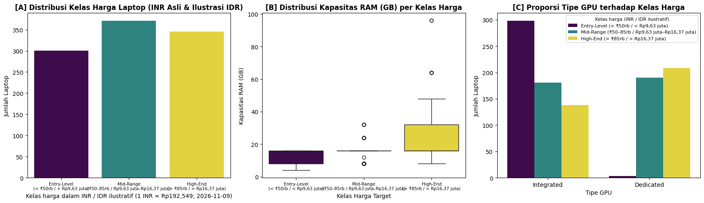
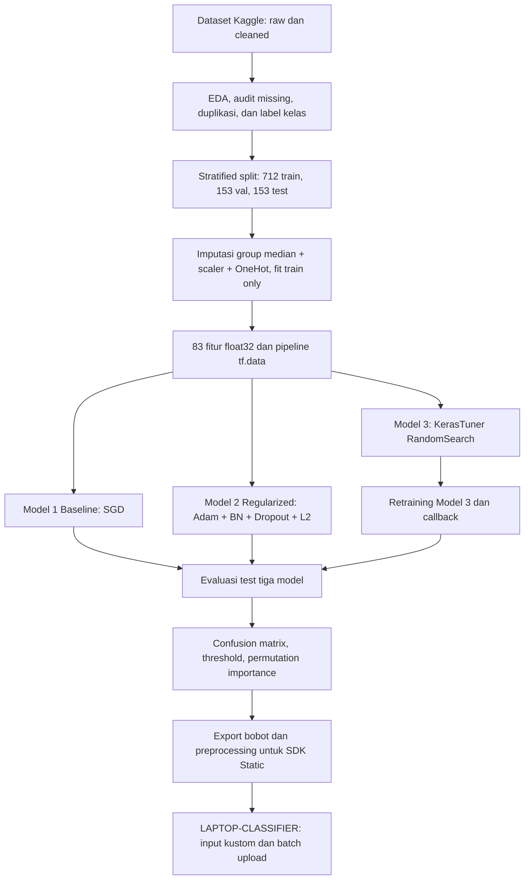
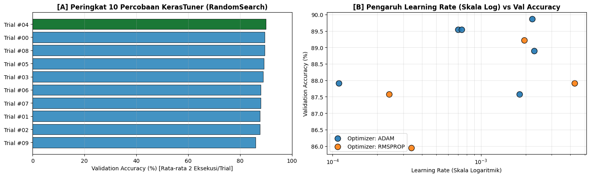
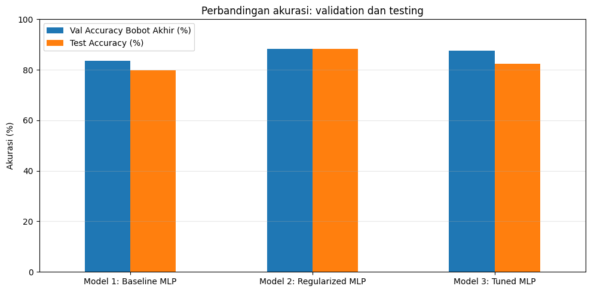
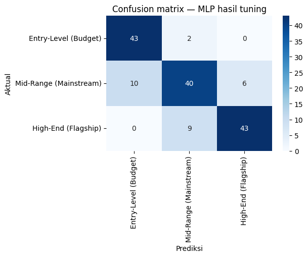
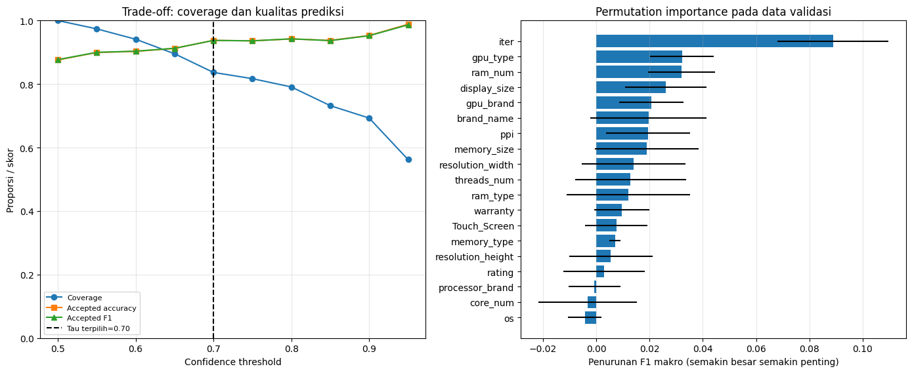
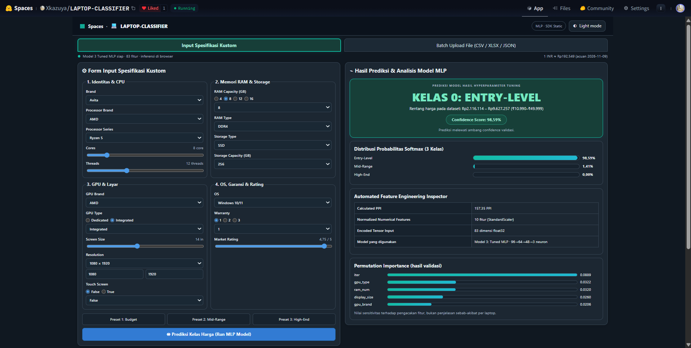
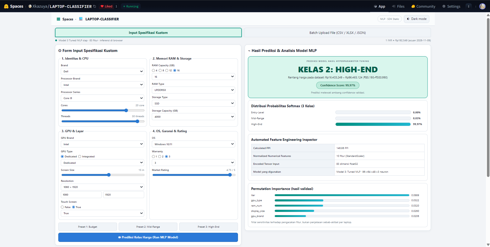
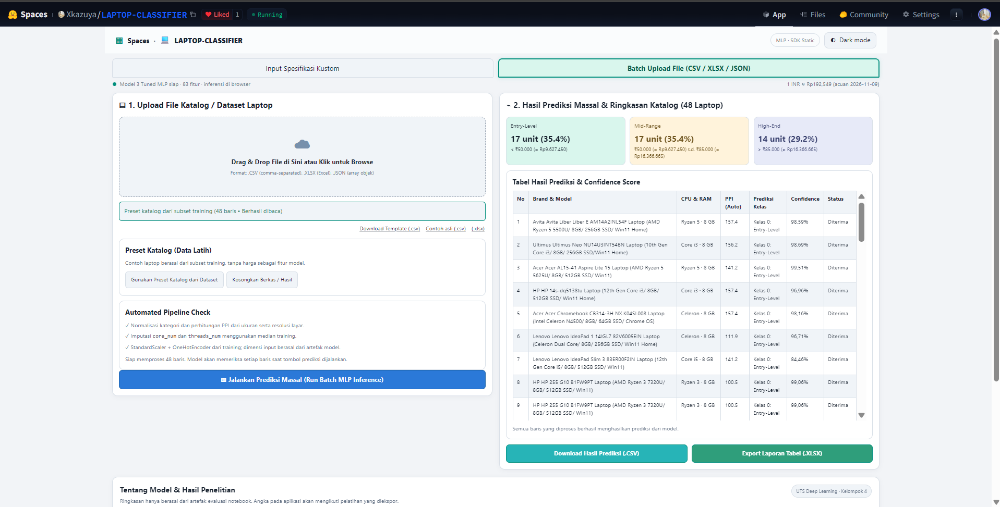
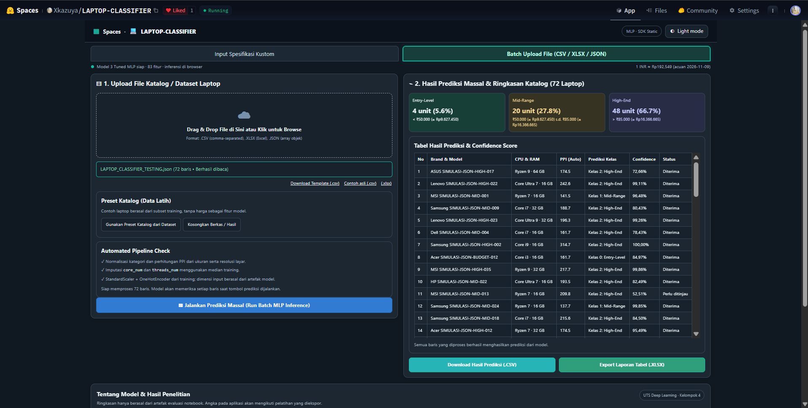

<div align="center">

# Klasifikasi Kelas Harga Laptop Berdasarkan Spesifikasi Teknis Menggunakan Arsitektur Multi-Layer Perceptron (MLP) dengan Hyperparameter Tuning
# UTS · DEEP LEARNING 

**Universitas Mikroskil · S-1 Teknik Informatika · Semester Ganjil 2026/2027**


## KELOMPOK 4 · IF-B PAGI
**Purba Tua Siregar** (231112463) · **Havidz Andrian** (231111899)  
**Mikkael Raynala Tampubolon** (231112313) · **Ipaldi Jagarojes Sembiring** (231112081)  
**Muhammad Dhani Irvansyah** (231112747)

**Dosen:** Syanti Irviantina, S.Kom., M.Kom.

### [Buka Web LAPTOP-CLASSIFIER](https://huggingface.co/spaces/Xkazuya/LAPTOP-CLASSIFIER) · [Buka Notebook Final](notebooks/UTS_DEEP_LEARNING_KELOMPOK_4_FINALE.ipynb) · [Baca Laporan PDF](reports/Laporan_UTS_Deep_Learning_Kelompok_4.pdf)

*Model utama penelitian: **Model 3 - Tuned MLP (96→64→48)** · 83 fitur · 3 kelas harga*

</div>

---

<a id="navigasi"></a>
## Navigasi Cepat

| Mulai dari sini | Penjelasan lebih lanjut |
| --- | --- |
| [Masalah dan tujuan](#masalah-dan-tujuan) | [Dataset dan label](#dataset-dan-label) |
| [Alur eksperimen](#alur-eksperimen) | [Model dan konfigurasi](#model-dan-konfigurasi) |
| [Hasil evaluasi](#hasil-evaluasi) | [Dua fitur unik](#dua-fitur-unik) |
| [Demo Hugging Face](#demo-hugging-face) | [Testing CSV / XLSX / JSON](#uji-batch-csv-xlsx-json) |
| [Galeri 14 section](docs/GALLERY.md) | [Peta semua section](docs/SECTION_MAP.md) |
| [Dokumentasi eksperimen](docs/EXPERIMENTS.md) | [Cuplikan source code](docs/CODE_GUIDE.md) |
| [Daftar tabel hasil](docs/TABLE_INDEX.md) | [Cara menjalankan ulang](docs/REPRODUCIBILITY.md) |
| [Alasan memilih SDK Static](docs/DEPLOYMENT.md) | [Source UI terbaru](docs/WEB_SOURCE.md) |
| [Struktur repository](#struktur-repository) | [Sumber dan keterbatasan](#sumber-dan-keterbatasan) |

<a id="masalah-dan-tujuan"></a>
## 1. Masalah dan Tujuan

Harga laptop tidak hanya dipengaruhi satu komponen. Dua laptop dengan RAM yang sama dapat masuk kelas harga berbeda karena prosesor, GPU, resolusi layar, kapasitas penyimpanan, atau gabungan spesifikasi lainnya. Kami menggunakan jaringan saraf **Multi-Layer Perceptron (MLP)** untuk mempelajari hubungan antarfaktor tersebut dan mengelompokkan laptop ke tiga segmen harga.

Tujuan UTS kami adalah membangun alur pemrosesan data tabular yang bisa digunakan kembali, membandingkan MLP baseline dan regularized dengan **MLP hasil KerasTuner RandomSearch**, mengukur performa pada data test yang dipisahkan, serta mengembangkan demonstrasi inferensi pada Hugging Face Spaces. Penilaian utama adalah kualitas **klasifikasi kelas harga**, bukan regresi nominal harga laptop.

<a id="dataset-dan-label"></a>
## 2. Dataset dan Label

**Sumber:** [Kaggle - Laptop Specifications and Prices Dataset (`anshsahu111`)](https://www.kaggle.com/datasets/anshsahu111/laptop-specifications-and-prices-dataset).

| Pemeriksaan | Nilai dalam notebook final |
| --- | --- |
| Dataset mentah | 1.020 laptop × 12 kolom |
| Dataset hasil ekstraksi | **1.018 laptop × 22 kolom** |
| Fitur prediktor asli | **10 numerik + 9 kategorikal** |
| Setelah preprocessing | **83 dimensi `float32`** |
| Data train / validation / test | **712 / 153 / 153** (stratified 70/15/15) |
| Missing value awal | **77 threads + 22 core = 99** |
| Kelas Entry-Level | **301 (29,57%)** |
| Kelas Mid-Range | **371 (36,44%)** |
| Kelas High-End | **346 (33,99%)** |

**Definisi kelas dari INR asli:** Entry-Level < ₹50.000; Mid-Range ₹50.000–₹85.000; High-End > ₹85.000. Konversi **1 INR ≈ Rp192,549** (acuan tetap 9 November 2026) hanyalah konteks bagi pembaca Indonesia. Harga dan identitas produk **tidak** dipakai sebagai masukan ke jaringan.



[Audit lengkap, distribusi, histogram, dan skema input](docs/DATASET.md) · [Daftar 19 atribut](data/SCHEMA.md)

<a id="alur-eksperimen"></a>
## 3. Alur Eksperimen



**Pencegahan kebocoran:** statistik imputasi, standardisasi, dan encoding di-*fit* hanya pada data **training**. Validation dipakai untuk memilih hyperparameter dan ambang confidence. Testing digunakan untuk mengukur hasil akhir kandidat. Audit produk yang berulang dan uji pemisahan berdasarkan nama model juga dibahas sebagai keterbatasan generalisasi.

Seluruh alur dijelaskan dalam [peta 14 section](docs/SECTION_MAP.md), dengan galeri dan tabel terhubung ke output notebook.

<a id="model-dan-konfigurasi"></a>
## 4. Model dan Konfigurasi

Ketiganya merupakan **DNN berbasis MLP**, sesuai karakteristik dataset tabular; **CNN tidak digunakan** karena data tidak berbentuk citra.

| Aspek | Model 1 · Baseline | Model 2 · Regularized | **Model 3 · Tuned (utama)** |
| --- | --- | --- | --- |
| Hidden layer | 64 → 32 | 128 → 64 → 32 | **96 → 64 → 48** |
| Optimizer | SGD | Adam | Adam hasil KerasTuner |
| Regularisasi | Tidak memakai BN/Dropout/L2 | BN, Dropout, L2 | BN, Dropout 0,2, L2 |
| Jumlah parameter | 7.555 | 22.083 | **18.371** |

KerasTuner menjalankan **RandomSearch: 10 trial × 2 eksekusi**. Konfigurasi terbaik memakai `learning_rate=0.0022119679`, `L2≈0.0000195287`, tiga hidden layer, dan batch size 32. Pelatihan ulang memakai `EarlyStopping`, `ReduceLROnPlateau`, `ModelCheckpoint` dan `CSVLogger`. Pelatihan Model 3 berhenti pada epoch 36; bobot terbaik diambil dari epoch 21 menurut validation loss. Accuracy validasi puncak **90,20%** dan accuracy pada bobot terpulihkan **87,58%** adalah ukuran pada titik berbeda.



<a id="hasil-evaluasi"></a>
## 5. Hasil Evaluasi

| Metrik pada 153 data testing | Model 1 Baseline | Model 2 Regularized | **Model 3 Tuned (utama)** |
| --- | ---: | ---: | ---: |
| Accuracy | 79,74% | **88,24%** | **82,35%** |
| Precision makro | 0,7974 | **0,8824** | 0,8244 |
| Recall makro | 0,8065 | **0,8887** | 0,8323 |
| F1 makro | 0,7990 | **0,8843** | **0,8256** |
| Benar / salah | 122 / 31 | 135 / 18 | **126 / 27** |

**Hasil penting:** Model 3 meningkat **2,61 poin persentase** dibandingkan baseline, tetapi **Model 2 lebih baik pada data test**. Kami tetap menggunakan Model 3 sebagai fokus penelitian dan aplikasi karena judul proyek mempelajari *MLP dengan Hyperparameter Tuning*. Hasil tuning tidak dinyatakan sebagai kemenangan terhadap semua pembanding.



<details>
<summary><strong>Analisis kesalahan tiga kelas (klik untuk membuka)</strong></summary>

Pada Model 3, Entry-Level benar **43/45** (recall 95,56%), Mid-Range **40/56** (recall 71,43%), dan High-End **43/52** (recall 82,69%). Mid-Range paling sering tertukar dengan kelas lain karena spesifikasinya dapat tumpang tindih antarsektor harga.



</details>

[Evaluasi, ablasi, lima seed, dan batas generalisasi](docs/EXPERIMENTS.md)

<a id="dua-fitur-unik"></a>
## 6. Dua Fitur Unik

| Fitur | Implementasi dan hasil terukur |
| --- | --- |
| **Confidence Threshold** | Ambang **0,70** dipilih dari validation. Pada test, **126/153** prediksi diterima otomatis, **27** ditandai *Perlu Ditinjau*. Akurasi subset diterima **89,68%** (bukan akurasi total). **14 dari 27** kesalahan awal ditandai. |
| **Permutation Importance** | Setiap fitur asli diacak **10 kali** pada validation. Penurunan F1 makro terbesar ada pada `iter` **0,08892**, `gpu_type` **0,03215**, dan `ram_num` **0,03196**. Ini ukuran sensitivitas prediksi, bukan penjelasan kausal. |



<a id="demo-hugging-face"></a>
## 7. Deployment Hugging Face - LAPTOP-CLASSIFIER

**Jalankan aplikasi:** [Xkazuya/LAPTOP-CLASSIFIER](https://huggingface.co/spaces/Xkazuya/LAPTOP-CLASSIFIER) · [Dokumentasi lengkap UI dan 6 screenshot](docs/HUGGING_FACE.md) · [Source frontend](web_static/README.md) · [Alasan SDK Static dan cara deploy](docs/DEPLOYMENT.md)

Aplikasi ini menerapkan **Model 3 (Tuned MLP)**, bukan model lain. Kami memilih **Hugging Face Spaces SDK Static** agar dosen dan pengguna dapat mencoba klasifikasi lewat browser tanpa menjalankan Python atau menunggu training ulang. HTML membentuk antarmuka, CSS mengatur responsivitas dan tema, JavaScript memproses form/file serta melakukan inferensi dari artefak bobot dan preprocessing asli yang berada di Space. Tidak memakai Gradio. Perlu diperhatikan: `index.html` dan `app.js` pada GitHub ini merupakan **salinan persis file terbaru yang diunggah tim**; detail status sumber tiga file pendamping dijelaskan di [WEB_SOURCE.md](docs/WEB_SOURCE.md).

### Fitur website

| Fitur | Yang dapat dilakukan | Bukti |
| --- | --- | --- |
| **Dual Mode - Light/Dark** | Ganti tema dengan satu klik tanpa memengaruhi prediksi model | [Screenshot tema gelap](docs/huggingface/kustom_budget_dark_9859.png) / [terang](docs/huggingface/kustom_highend_light_9997.png) |
| **Dual Price - INR/IDR** | Lihat kelas harga dari INR asli dan rupiah ilustratif dengan kurs acuan tetap **1 INR ≈ Rp192,549** | [Penjelasan konversi](docs/HUGGING_FACE.md#dual-price-bagaimana-rupiah-dihitung) |
| **Input kustom** | Dropdown brand, CPU, GPU, OS, RAM dan penyimpanan; radio, slider, resolusi, garansi, rating | [Source HTML](web_static/index.html) |
| **Tiga preset cepat** | Budget, Mid-Range, High-End sebagai contoh input; keluaran tetap dihitung model | [Screenshot Budget](docs/huggingface/kustom_budget_dark_9859.png) |
| **Hasil prediksi** | Kelas 0/1/2, confidence dan tiga probabilitas Softmax, PPI, 83 fitur, status peninjauan | [Dokumentasi prediksi](docs/HUGGING_FACE.md#tab-1-input-spesifikasi-kustom) |
| **Batch upload** | Baca CSV, XLSX, JSON; validasi tiap baris; ringkasan tiga kelas dan tabel hasil | [Dokumentasi batch](docs/HUGGING_FACE.md#tab-2-batch-upload-csv-xlsx-json) |
| **Preset katalog** | Prediksi massal pada subset training yang dipakai untuk demonstrasi | [Screenshot 48 laptop](docs/huggingface/batch_preset_training_48_light.png) |
| **Unduh hasil** | Ekspor CSV atau XLSX berisi kelas, probabilitas, confidence, status, PPI | [Source app.js](web_static/app.js) |
| **Dua fitur unik** | Confidence threshold 0,70 dan permutation importance hasil validasi | [Bukti notebook](docs/stages/11.md) |

### TAMPILAN WEBSITE HUGGINGFACE LAPTOP-CLASSIFIER

| **Input kustom - Preset Budget (Dark Mode)** | **Input kustom - High-End (Light Mode)** |
| --- | --- |
|  |  |
| **Entry-Level**, confidence **98,59%**, PPI **157,35** | **High-End**, confidence **99,97%**, probabilitas kelas 2 paling tinggi |

| **Batch preset training (48 laptop, Light Mode)** | **Batch JSON skenario (72 laptop, Dark Mode)** |
| --- | --- |
|  |  |
| **17 Entry-Level · 17 Mid-Range · 14 High-End** | **4 Entry-Level · 20 Mid-Range · 48 High-End** |

<a id="uji-batch-csv-xlsx-json"></a>
### Demo batch - hasil sesuai screenshot pengujian

| Berkas / mode | Jumlah | Entry-Level | Mid-Range | High-End | Bukti screenshot |
| --- | ---: | ---: | ---: | ---: | --- |
| Preset training | 48 | 17 (35,4%) | 17 (35,4%) | 14 (29,2%) | [Buka](docs/huggingface/batch_preset_training_48_light.png) |
| [CSV sintetis](data/testing/batch_uji_18_laptop.csv) | 18 | 0 (0,0%) | 13 (72,2%) | 5 (27,8%) | [Buka](docs/huggingface/batch_csv_18.png) |
| [XLSX sintetis](data/testing/batch_uji_40_laptop.xlsx) | 40 | 2 (5,0%) | 16 (40,0%) | 22 (55,0%) | [Buka](docs/huggingface/batch_xlsx_40.png) |
| [JSON sintetis](data/testing/batch_uji_72_laptop.json) | 72 | 4 (5,6%) | 20 (27,8%) | 48 (66,7%) | [Buka](docs/huggingface/batch_json_72_dark_667.png) |

Pengujian CSV, XLSX, dan JSON dibuat untuk menguji alur pembacaan file, inferensi batch, dan variasi keluaran, **bukan data berlabel untuk menghitung akurasi**. Akurasi **82,35%** berasal dari pengujian **153 observasi berlabel di Colab**, bukan dari file simulasi di website. Confidence **98,59%** atau **99,97%** pada satu input adalah skor Softmax, bukan akurasi sistem secara keseluruhan.

**Baca:** [fitur, alur UI dan contoh hasil](docs/HUGGING_FACE.md) · [source code aplikasi dan hubungan dengan model](docs/WEB_SOURCE.md) · [langkah deployment dan pemeriksaan](docs/DEPLOYMENT.md) · [riwayat sumber screenshot](config/frontend_provenance.json).

<a id="galeri-dan-bukti-kode"></a>
## 8. Galeri dan Bukti Kode

Notebook mempunyai **14 section**, dengan **15 gambar output tersimpan** dan **30 tabel HTML yang berhasil diekstrak sebagai CSV**. Semua gambar dan tabel pada galeri berasal dari notebook final, bukan hasil pengukuran ulang.

| Materi | Bukti langsung |
| --- | --- |
| EDA dan audit data | [Distribusi, histogram dan korelasi](docs/stages/02.md) |
| Pemisahan dan preprocessing | [Kode imputasi train-only](docs/stages/03.md) |
| Model baseline dan regularisasi | [Pelatihan dan grafik pembanding](docs/stages/05.md) |
| KerasTuner | [Hasil trial dan konfigurasi](docs/stages/06.md) |
| Model tuned dan evaluasi | [Hasil test dan confusion matrix](docs/stages/08.md) |
| Dua fitur unik | [Threshold dan importance](docs/stages/11.md) |
| Ablasi serta multi-seed | [Tabel uji tambahan](docs/stages/12.md) |
| SDK Static | [Alur ekspor dan sumber frontend](docs/stages/13.md) |

**Galeri lengkap:** [semua gambar](docs/GALLERY.md) · [tabel output CSV](docs/TABLE_INDEX.md) · [gambar kode](docs/CODE_GUIDE.md)

<a id="menjalankan-proyek"></a>
## 9. Menjalankan Proyek

**Membaca hasil tanpa pelatihan ulang:** buka notebook yang menyimpan output, atau jelajahi `docs/` dan `results/recorded/`.

**Menjalankan eksperimen di Google Colab:** buka [notebook final](notebooks/UTS_DEEP_LEARNING_KELOMPOK_4_FINAL.ipynb), jalankan dari Section 1. `kagglehub` mengunduh dataset jika dua CSV tidak ditemukan. Saat runtime berbeda, hasil pelatihan dapat sedikit berubah. Untuk detail, lihat [panduan reproduksibilitas](docs/REPRODUCIBILITY.md).

**Menguji aplikasi web:** buka Space publik, gunakan preset atau impor file di `data/testing/`, kemudian lihat kelas/confidence yang dihitung oleh model. Berkas pada `web_static/` adalah **referensi source frontend tanpa bobot model produksi**; untuk source yang identik dengan deployment terbaru lihat [Files pada Hugging Face](https://huggingface.co/spaces/Xkazuya/LAPTOP-CLASSIFIER/tree/main).

**Audit integritas isi ZIP (opsional):**

```bash
python scripts/verify_repository.py
```

<a id="struktur-repository"></a>
## 10. Struktur Repository

```text
UTS-DEEP-LEARNING/
├── README.md                 # Ringkasan, navigasi, hasil dan deployment
├── notebooks/                # Notebook final 14 section, dengan output tersimpan
├── reports/                  # Laporan UTS: PDF + DOCX
├── src/                      # Ekspor source kode dari notebook (bukan run baru)
├── data/
│   ├── SCHEMA.md             # 19 fitur dan definisi kelas
│   └── testing/              # CSV 18, XLSX 40, JSON 72 (input simulasi)
├── docs/
│   ├── GALLERY.md            # Galeri grafik dari output notebook
│   ├── SECTION_MAP.md        # Peta 14 section
│   ├── EXPERIMENTS.md        # Evaluasi, tuning, ablasi dan fitur unik
│   ├── HUGGING_FACE.md       # Dua tab, screenshot, hasil demo, SDK Static
│   ├── CODE_GUIDE.md         # Gambar potongan kode dari notebook
│   ├── stages/               # Penjelasan Section 01–14
│   ├── images/               # 15 grafik output asli
│   ├── code/                 # Cuplikan kode sumber
│   └── huggingface/          # 8 screenshot pengujian aplikasi
├── results/recorded/        # Tabel output tersimpan + manifest + checksum
├── web_static/              # HTML/JS terbaru dari unggahan tim; CSS/inferensi referensi
├── scripts/                 # Pemeriksaan paket dan upload satu klik di Windows
├── PUSH_KE_GITHUB.cmd       # Jalur upload via CMD dengan Git terautentikasi
└── .gitignore
```

<a id="sumber-dan-keterbatasan"></a>
## 11. Sumber, Keterbatasan, dan Kesimpulan

**Dataset:** Kaggle `anshsahu111` ([halaman sumber](https://www.kaggle.com/datasets/anshsahu111/laptop-specifications-and-prices-dataset)). **Library:** TensorFlow/Keras, KerasTuner, scikit-learn, Pandas, NumPy. **Deployment:** Hugging Face Spaces SDK Static. Lihat [daftar sumber](docs/REFERENCES.md).

Kami berhasil menerapkan **MLP dengan hyperparameter tuning** untuk klasifikasi tiga kelas harga laptop. Model utama menghasilkan **82,35% accuracy** dan **0,8256 F1 makro** pada 153 data testing. Peningkatan terhadap baseline terukur, tetapi masih ada tantangan pada kelas Mid-Range dan Model 2 tetap memiliki hasil testing lebih tinggi. Metrik berasal dari notebook; prediksi pada data simulasi website bukan bagian dari perhitungan akurasi ini.

Keterbatasan mencakup duplikasi produk, variasi antar-runtime, data yang berasal dari satu katalog, prediksi GPU yang belum sampai seri RTX/GTX, dan ekuivalen IDR yang hanya ilustrasi. Lihat [pembahasan keterbatasan](docs/LIMITATIONS.md) untuk rencana penyempurnaan. Untuk peran pembicara lihat [anggota kelompok](docs/TEAM.md).

**Laporan akademik:** [PDF](reports/Laporan_UTS_Deep_Learning_Kelompok_4.pdf) · [DOCX](reports/Laporan_UTS_Deep_Learning_Kelompok_4.docx)  
**Notebook:** [UTS_DEEP_LEARNING_KELOMPOK_4_FINAL.ipynb](notebooks/UTS_DEEP_LEARNING_KELOMPOK_4_FINAL.ipynb)  
**Website:** [Xkazuya/LAPTOP-CLASSIFIER](https://huggingface.co/spaces/Xkazuya/LAPTOP-CLASSIFIER)  
**Video demo:** tautan publik akan ditambahkan setelah tersedia; tidak dicantumkan tautan yang belum diverifikasi.

---

<div align="center"><sub>UTS · DEEP LEARNING · KELOMPOK 4 · LAPTOP CLASSIFIER · UNIVERSITAS MIKROSKIL</sub></div>
