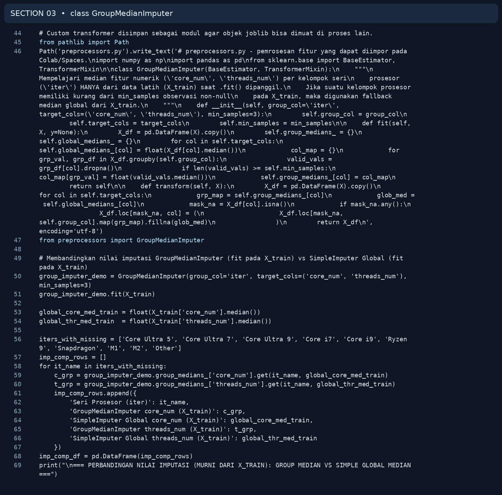
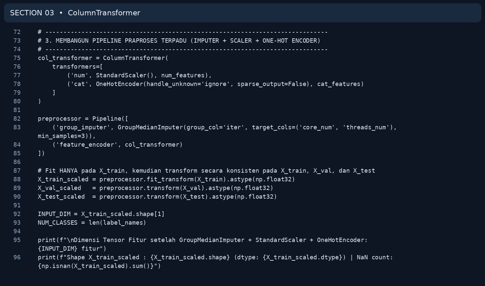
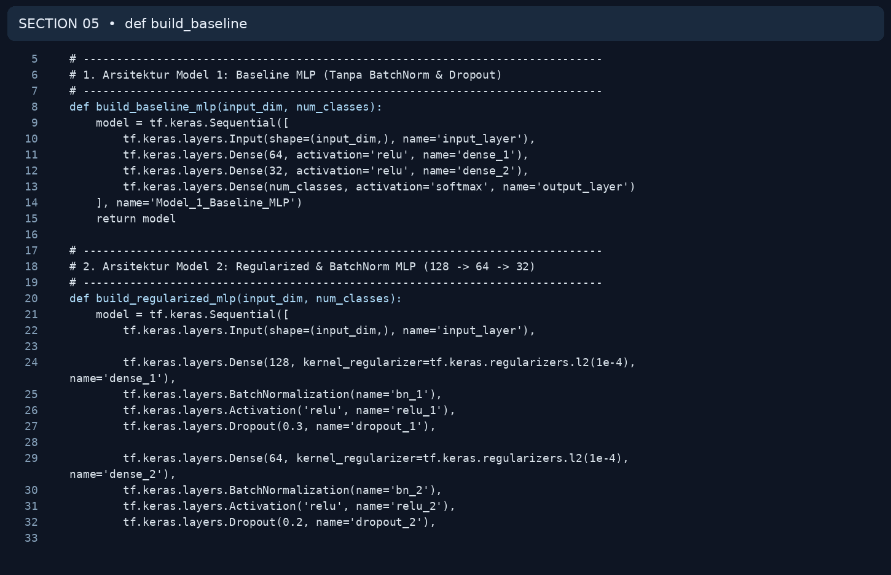
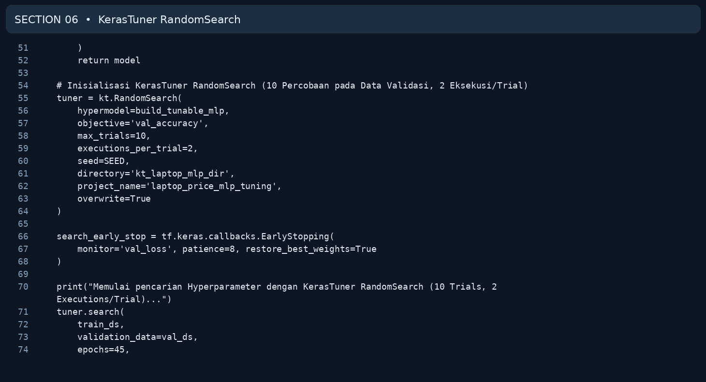
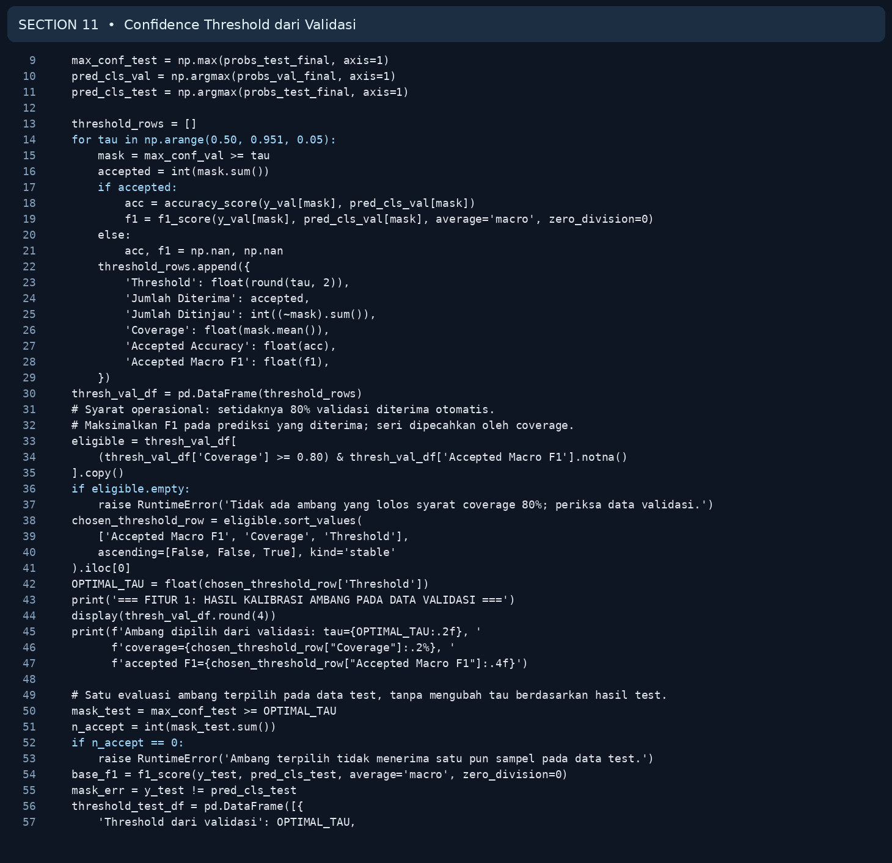
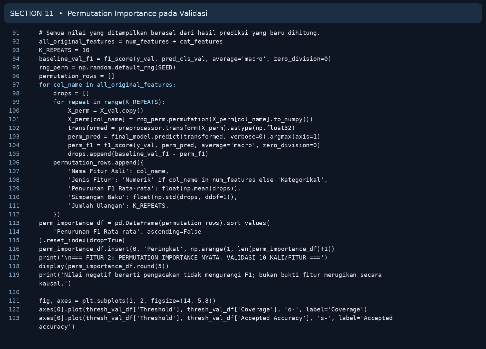
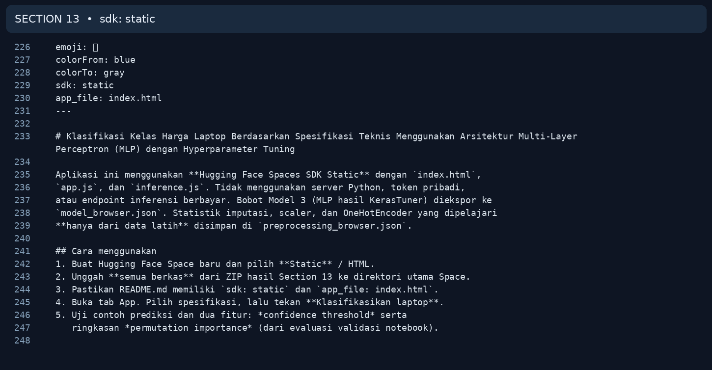

# Cuplikan Kode dari Notebook Final

[Kembali ke README](../README.md) · [Notebook final](../notebooks/UTS_DEEP_LEARNING_KELOMPOK_4_FINAL.ipynb)

Cuplikan berikut dibuat dari teks kode notebook asli. **Tidak ada algoritme baru atau nilai hasil training yang ditambahkan.** Untuk menjalankannya buka file `.ipynb`.

## Section 3: class GroupMedianImputer

*Cuplikan baris 44–69 dari Section 3 notebook.*

## Section 3: ColumnTransformer

*Cuplikan baris 72–96 dari Section 3 notebook.*

## Section 5: def build_baseline

*Cuplikan baris 5–33 dari Section 5 notebook.*

## Section 6: KerasTuner RandomSearch

*Cuplikan baris 51–74 dari Section 6 notebook.*

## Section 11: Confidence Threshold dari Validasi

*Cuplikan baris 9–57 dari Section 11 notebook.*

## Section 11: Permutation Importance pada Validasi

*Cuplikan baris 91–123 dari Section 11 notebook.*

## Section 13: sdk: static

*Cuplikan baris 226–248 dari Section 13 notebook.*

## Dokumentasi terbaru website

[Bukti Light/Dark, input kustom, batch 48/18/40/72](HUGGING_FACE.md) · [Source UI terbaru](WEB_SOURCE.md) · [Alasan serta tahap deployment](DEPLOYMENT.md).
