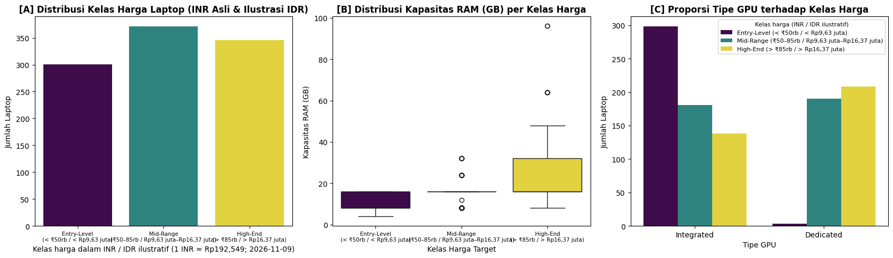

# Sumber, Label, dan Audit Dataset

[README](../README.md) · [Skema](../data/SCHEMA.md) · [Section 2](stages/02.md)

Sumber yang digunakan adalah [Laptop Specifications and Prices Dataset](https://www.kaggle.com/datasets/anshsahu111/laptop-specifications-and-prices-dataset) dari Kaggle (`anshsahu111`). Berkas mentah **1.020 × 12**, sedangkan berkas analisis yang sudah tersedia pada dataset **1.018 × 22**. Eksperimen mengambil file yang sama ketika notebook dijalankan, bukan mencampur satu file dengan yang lain.

| Kelas | Harga INR | Perkiraan rupiah (kurs tetap 1 INR ≈ Rp192,549) | Jumlah |
| --- | --- | --- | ---: |
| 0 · Entry-Level | < ₹50.000 | < Rp9.627.450 | 301 |
| 1 · Mid-Range | ₹50.000–₹85.000 | Rp9.627.450–Rp16.366.665 | 371 |
| 2 · High-End | > ₹85.000 | > Rp16.366.665 | 346 |

Audit awal mencatat **77 threads kosong**, **22 core kosong**, **78 duplikasi baris persis**, serta **172 spesifikasi teknis identik**. Imputasi dilatih hanya dari training dan kasus produk berulang dibahas sebagai keterbatasan. Dua baris mentah yang tidak terpetakan ke berkas cleaned tidak diisi ulang secara spekulatif.

Sumber raw/cleaned asli tidak dibundel dalam ZIP ini. Folder [`data/testing`](../data/testing) berisi **data simulasi untuk demo**, bukan observasi berlabel yang digunakan menghitung metrik 82,35%.
