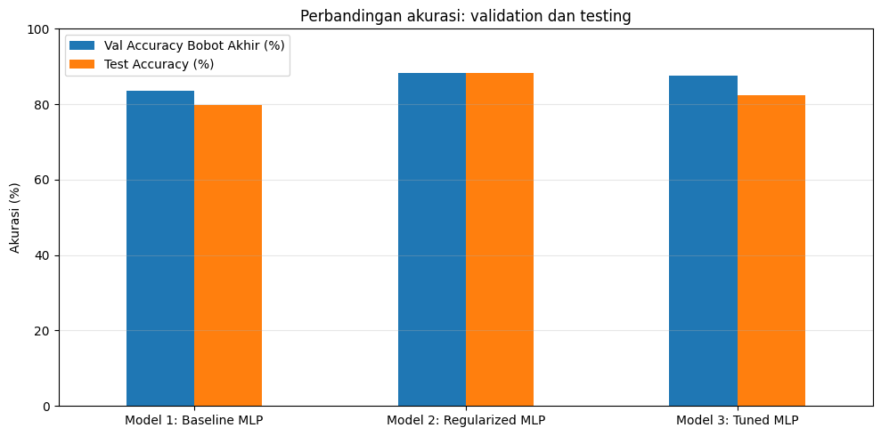
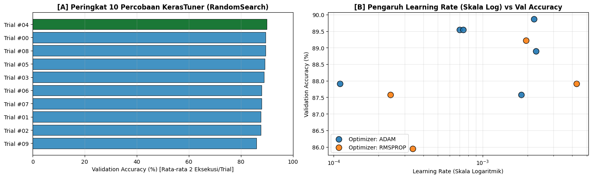
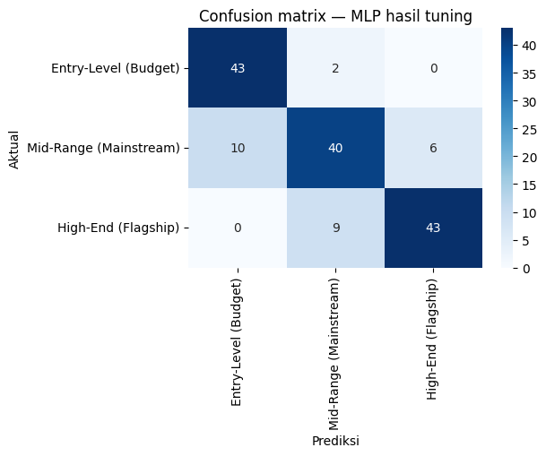
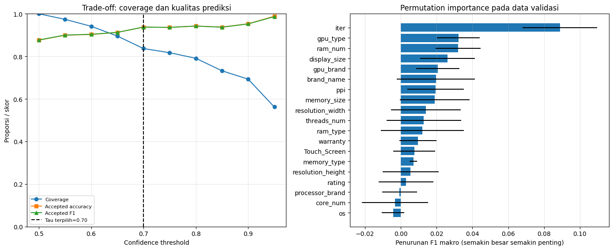

# Rancangan Eksperimen dan Hasil Aktual

[README](../README.md) · [Section](SECTION_MAP.md) · [Galeri](GALLERY.md)

## Desain dan target

Proyek merupakan klasifikasi 3 kelas harga, bukan prediksi nominal harga. Seluruh kandidat memakai 19 atribut spesifikasi yang ditransformasi menjadi 83 fitur. Data dibagi secara stratified menjadi training 712, validation 153, dan testing 153. Statistik imputasi, standardisasi, dan encoding berasal hanya dari training. **Model 3 Tuned MLP ditetapkan sebagai model utama sesuai judul**, meskipun pembanding lain lebih tinggi pada data uji.

## Tiga model yang dibandingkan

| Keterangan | Model 1 Baseline | Model 2 Regularized | Model 3 Tuned — utama |
| --- | ---: | ---: | ---: |
| Hidden layer | 64→32 | 128→64→32 | 96→64→48 |
| Parameter | 7.555 | 22.083 | 18.371 |
| Optimizer | SGD | Adam | Adam (hasil KerasTuner) |
| Accuracy testing | **79,74%** | **88,24%** | **82,35%** |
| Precision makro | 0,7974 | 0,8824 | 0,8244 |
| Recall makro | 0,8065 | 0,8887 | 0,8323 |
| F1 makro | 0,7990 | 0,8843 | 0,8256 |
| Benar / salah (dari 153) | 122 / 31 | 135 / 18 | 126 / 27 |

## Konfigurasi Model 3

- `KerasTuner RandomSearch` dengan **10 trial × 2 eksekusi** tiap trial.
- Arsitektur **Dense 96→64→48**, dengan Batch Normalization, ReLU, Dropout 0,2 pada dua lapisan awal, L2 sekitar 0,0000195287.
- Adam dengan learning rate awal 0,0022119679; loss `SparseCategoricalCrossentropy`; batch 32.
- Callback `ReduceLROnPlateau`, `EarlyStopping`, `ModelCheckpoint`, dan `CSVLogger`.
- Retraining berhenti pada epoch 36; bobot dipulihkan dari epoch 21. Peak validation accuracy **90,20%** tidak sama dengan final restored validation accuracy **87,58%**.

## Mengapa Mid-Range menjadi tantangan

`Confusion matrix` Model 3 pada data test:

| Kelas aktual → prediksi | Entry-Level | Mid-Range | High-End | Recall |
| --- | ---: | ---: | ---: | ---: |
| Entry-Level (45) | **43** | 2 | 0 | 95,56% |
| Mid-Range (56) | 10 | **40** | 6 | 71,43% |
| High-End (52) | 0 | 9 | **43** | 82,69% |

Pada kelas menengah, kombinasi spesifikasi laptop lebih mudah tumpang tindih dengan segmen di bawah/atasnya. Pola kesalahan mendukung dugaan tersebut, tetapi bukan pembuktian penyebab spesifik setiap sampel.

## Dua fitur unik

**Confidence threshold**: ambang **0,70** ditentukan melalui data validasi. Pada test, **126 dari 153** prediksi diterima (coverage **82,35%**); **27** ditandai *Perlu Ditinjau*. Akurasi kelompok yang diterima **89,68%**—bukan akurasi keseluruhan. Sebanyak **14 dari 27** kesalahan masuk kelompok peninjauan.

**Permutation importance**: mengacak tiap fitur asli 10 kali pada validation dan mengukur perubahan F1 makro. Fitur dengan penurunan terbesar `iter` (0,08892), `gpu_type` (0,03215), dan `ram_num` (0,03196). Pengukuran ini menunjukkan ketergantungan model, tidak membuktikan pengaruh sebab-akibat.

## Ablasi, multi-seed, dan batasannya

Pada ablasi A→B, mengganti SGD dengan Adam meningkatkan F1 validasi dari 0,8502 ke 0,8763. Penambahan BatchNorm/Dropout/L2 tidak selalu meningkatkan setiap metrik. Model 3 pada lima seed memperoleh rerata accuracy validasi **87,71% ± 0,85 pp** dan F1 makro **0,87765 ± 0,00865**. Evaluasi group-disjoint menghasilkan accuracy sekitar **82,07%**, digunakan sebagai sensitivitas, bukan pengganti estimasi utama.

**Batasan:** terdapat duplikasi dan kemiripan model laptop antarsplit, sehingga metrik test tidak boleh dibaca sebagai jaminan pada semua laptop baru. Harga dalam IDR bersifat ilustratif; model tidak memperkirakan harga jual individual. Seluruh angka di atas berasal dari notebook final, bukan dari batch upload simulasi.
