# Galeri Hasil Notebook

[README](../README.md) · [Peta Section](SECTION_MAP.md) · [Daftar tabel](TABLE_INDEX.md) · [Website](HUGGING_FACE.md)

Semua gambar dalam galeri ini **diambil langsung dari output `image/png` yang tersimpan di notebook final**. Tidak ada kurva atau nilai evaluasi yang dibuat ulang. Untuk membaca penjelasannya, ikuti tautan halaman section.

### Section 2 — Distribusi kelas, harga, dan GPU

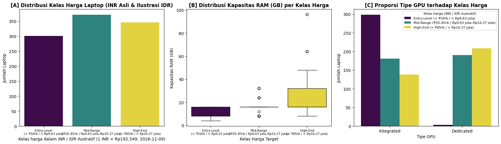

*Sumber: notebook Section 2, sel kode 5, output ke-11.*

### Section 2 — Histogram sepuluh fitur numerik

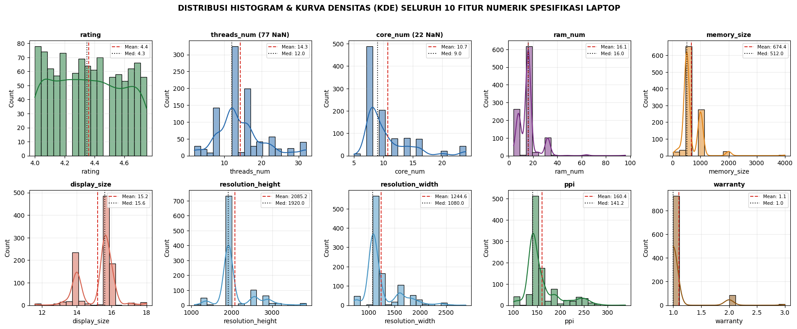

*Sumber: notebook Section 2, sel kode 5, output ke-12.*

### Section 2 — Matriks korelasi spesifikasi dan harga

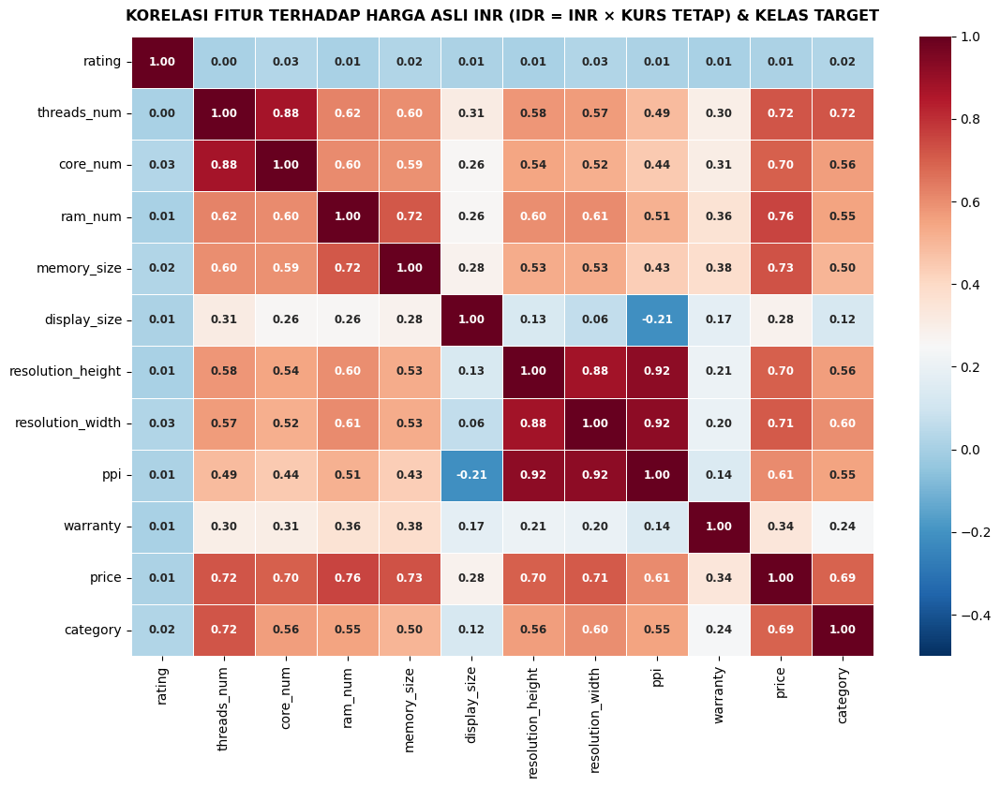

*Sumber: notebook Section 2, sel kode 5, output ke-13.*

### Section 5 — Kurva pelatihan dua model pembanding

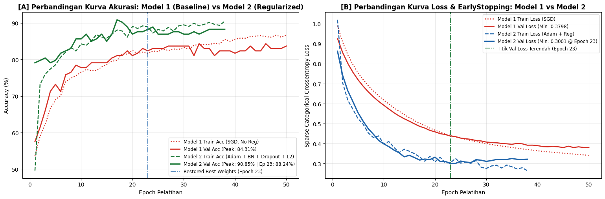

*Sumber: notebook Section 5, sel kode 14, output ke-13.*

### Section 6 — Peringkat trial KerasTuner dan learning rate

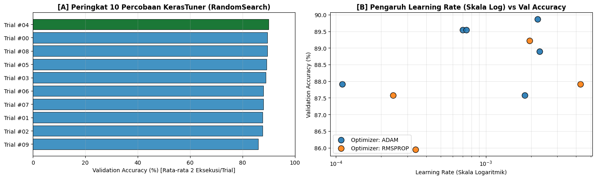

*Sumber: notebook Section 6, sel kode 17, output ke-2.*

### Section 8 — Confusion matrix model utama

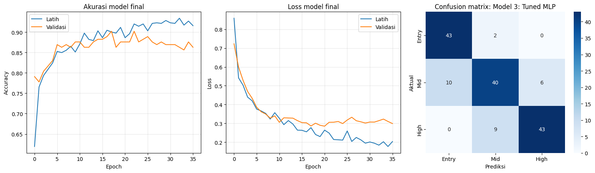

*Sumber: notebook Section 8, sel kode 23, output ke-6.*

### Section 9 — Audit kondisi baseline dan kualitas data

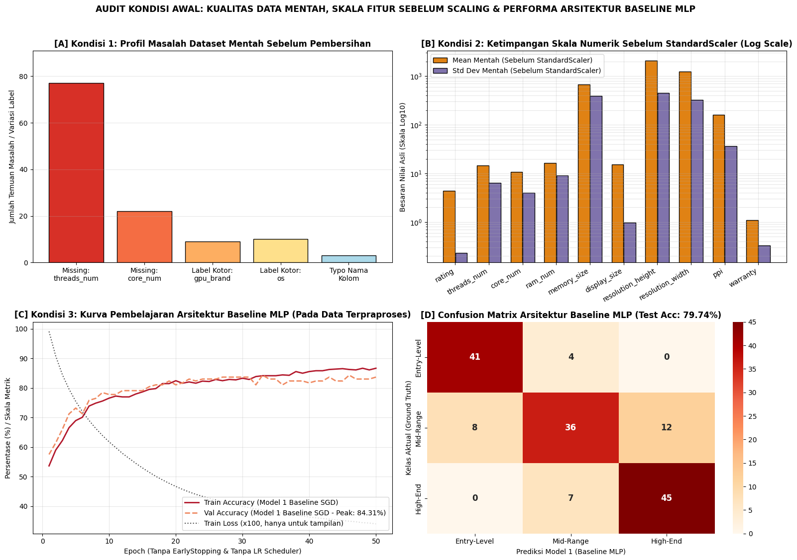

*Sumber: notebook Section 9, sel kode 26, output ke-2.*

### Section 10 — Perbandingan akurasi validation dan testing

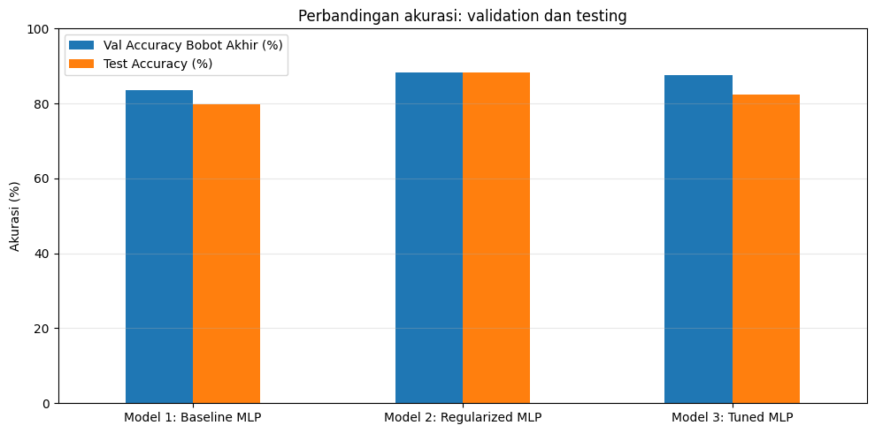

*Sumber: notebook Section 10, sel kode 29, output ke-4.*

### Section 11 — Ambang confidence dan permutation importance

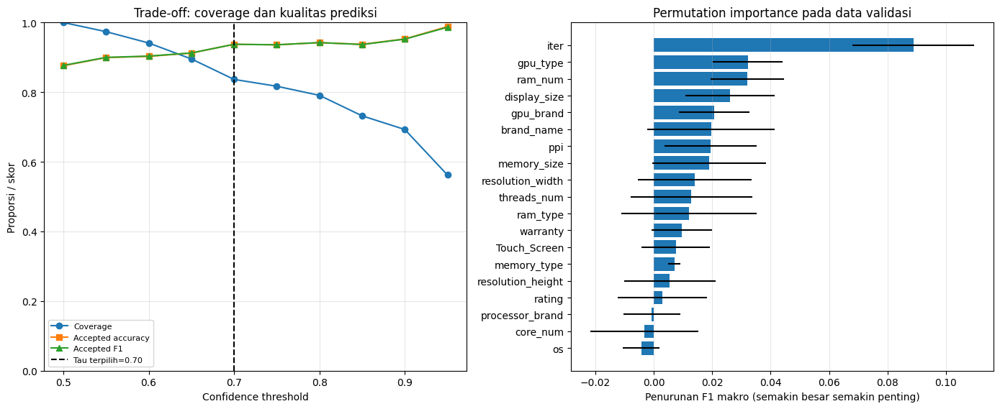

*Sumber: notebook Section 11, sel kode 32, output ke-7.*

### Section 12 — Perbandingan F1 makro pada percobaan ablasi

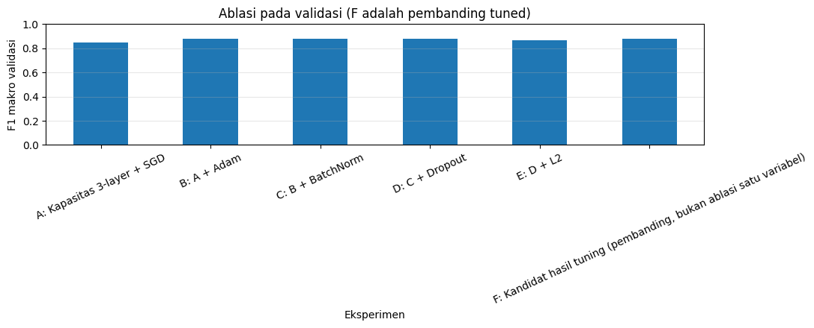

*Sumber: notebook Section 12, sel kode 35, output ke-6.*

### Section 14 — Kurva accuracy Tuned MLP

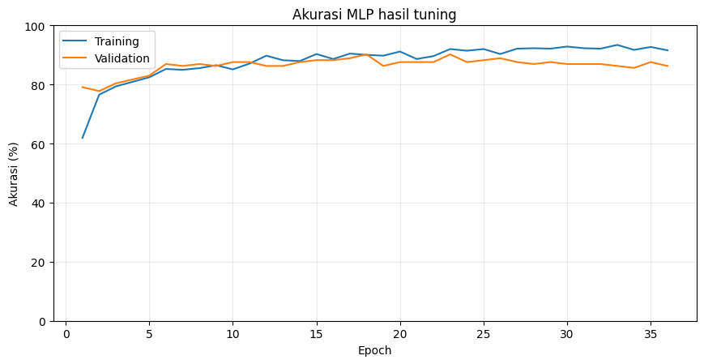

*Sumber: notebook Section 14, sel kode 40, output ke-2.*

### Section 14 — Kurva loss Tuned MLP

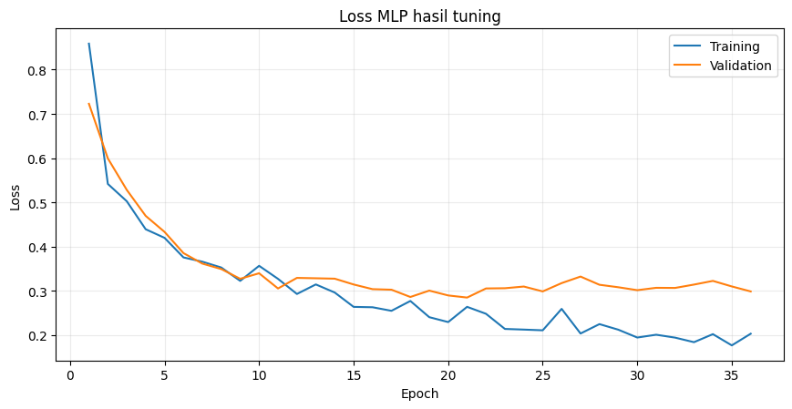

*Sumber: notebook Section 14, sel kode 40, output ke-3.*

### Section 14 — Confusion matrix Tuned MLP

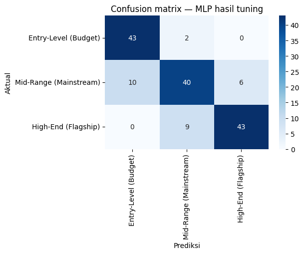

*Sumber: notebook Section 14, sel kode 40, output ke-4.*

### Section 14 — Grafik evaluasi tambahan

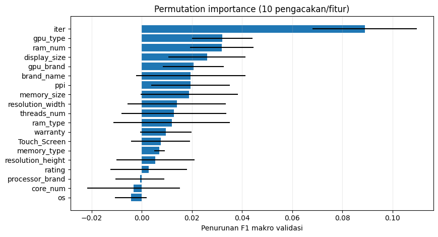

*Sumber: notebook Section 14, sel kode 40, output ke-5.*

### Section 14 — Visualisasi pendukung kesimpulan

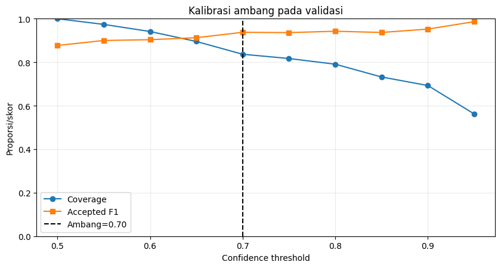

*Sumber: notebook Section 14, sel kode 40, output ke-6.*

## Dokumentasi terbaru website

[Bukti Light/Dark, input kustom, batch 48/18/40/72](HUGGING_FACE.md) · [Source UI terbaru](WEB_SOURCE.md) · [Alasan serta tahap deployment](DEPLOYMENT.md).
