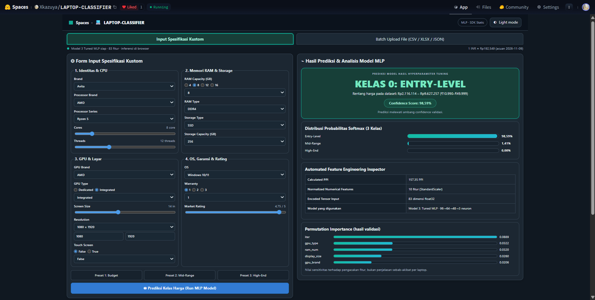
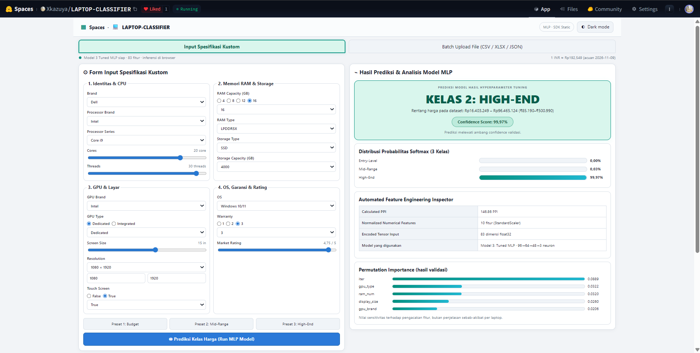
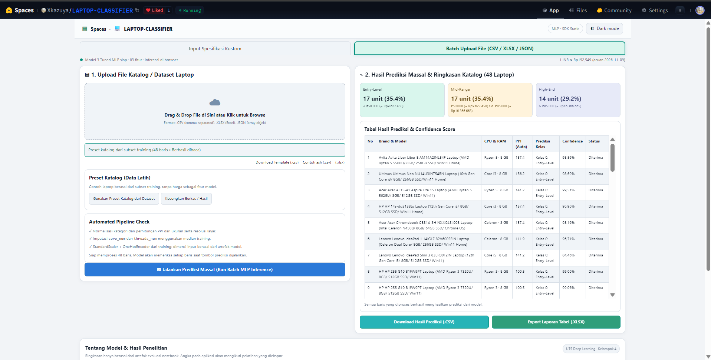
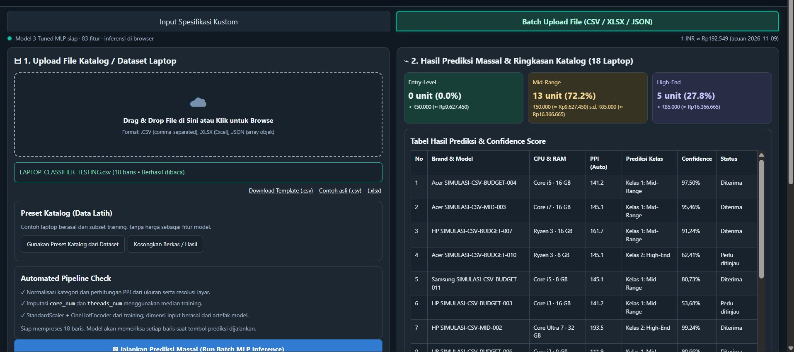
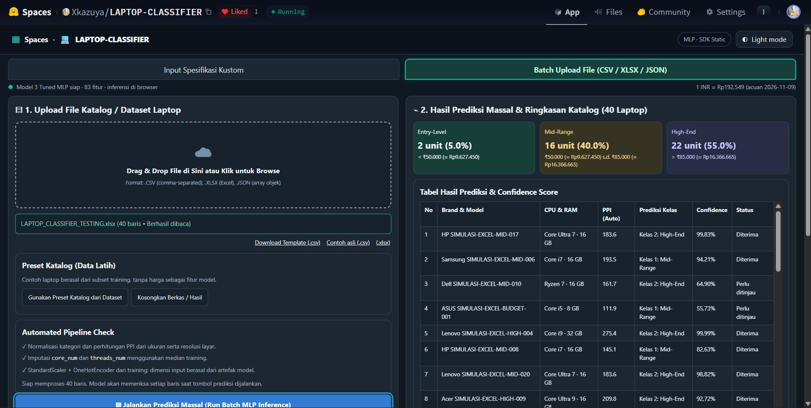
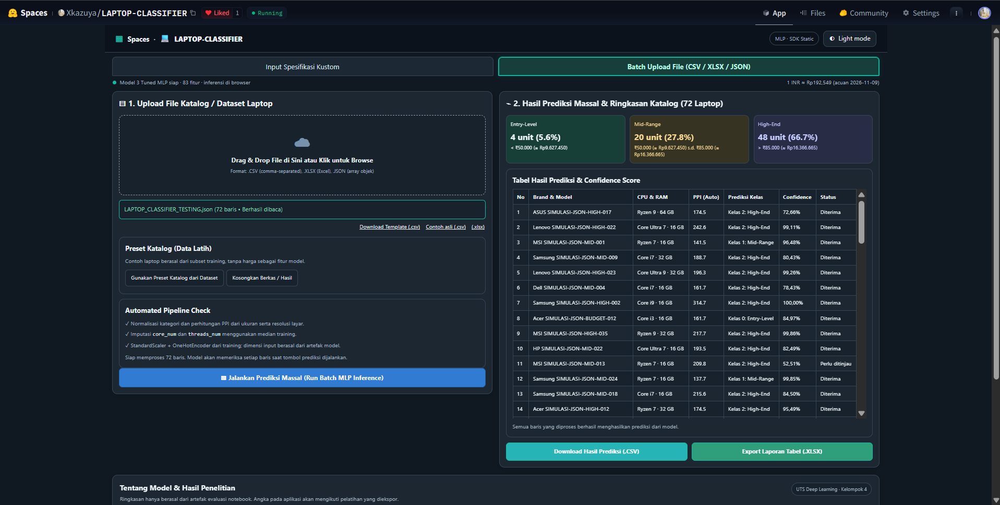

# Hugging Face Spaces — LAPTOP-CLASSIFIER

[README utama](../README.md) · [Buka aplikasi](https://huggingface.co/spaces/Xkazuya/LAPTOP-CLASSIFIER) · [Mengapa SDK Static?](DEPLOYMENT.md) · [Source UI](WEB_SOURCE.md) · [Hasil model](EXPERIMENTS.md)

## Gambaran aplikasi

**LAPTOP-CLASSIFIER** merupakan antarmuka untuk menguji **Model 3 Tuned MLP** hasil penelitian *Klasifikasi Kelas Harga Laptop Berdasarkan Spesifikasi Teknis Menggunakan Arsitektur Multi-Layer Perceptron (MLP) dengan Hyperparameter Tuning*. Model menggunakan **83 dimensi masukan** dan menghasilkan probabilitas **tiga kelas harga**. Melalui Hugging Face Spaces **SDK Static**, kalkulasi dijalankan pada browser menggunakan HTML, CSS, dan JavaScript—**tanpa Gradio dan tanpa backend Python untuk prediksi**.

Pengguna memiliki dua cara menjalankan prediksi: mengisi spesifikasi satu laptop melalui tab **Input Spesifikasi Kustom**, atau memproses sekumpulan laptop melalui tab **Batch Upload CSV / XLSX / JSON**. Setiap hasil dilengkapi informasi **dual price** (INR/IDR) dan **confidence score**.

### Fitur utama yang terlihat pada aplikasi

| Fitur | Cara kerja dan manfaat | Bukti kode/UI |
| --- | --- | --- |
| **Dual Mode (Light / Dark)** | Tombol tema di kanan atas mengganti warna seluruh halaman; preferensi disimpan dalam `localStorage` | [`setupUI()` di app.js](../web_static/app.js), [dua screenshot kustom](#tab-1-input-spesifikasi-kustom) |
| **Dual Currency (INR / IDR)** | Menampilkan rentang harga dalam INR asli dan IDR ilustratif memakai kurs referensi tetap **1 INR ≈ Rp192,549** (9 November 2026) | `priceDescription()`, `class_labels.json` dari Space |
| **Dropdown kategori dari training** | Opsi merek, seri CPU, RAM, GPU, OS dan kategori lain membaca keluaran encoder; hanya kategori yang dipelajari yang terdaftar | `options()`, `initForm()` |
| **Radio, slider dan preset** | Mempercepat input dan tetap mengizinkan penyesuaian kapasitas, jumlah core/thread, layar dan rating | `radioButtons()`, `ranges()`, `applyPreset()` |
| **Softmax 3 kelas** | Menampilkan tiga probabilitas model dan kelas dengan nilai tertinggi | `showPrediction()` |
| **Confidence threshold 0,70** | Di bawah 70% diberi status *Perlu Ditinjau*; bukan jaminan probabilitas terkalibrasi | `showPrediction()`, `renderBatch()` |
| **Feature Engineering Inspector** | Menampilkan PPI, jumlah fitur numerik dan total dimensi tensor 83, serta arsitektur MLP | `showPrediction()` |
| **Permutation Importance** | Menampilkan lima fitur teratas dari hasil validasi notebook, bukan penjelasan kausal individual | `showImportance()` |
| **Batch Reader** | Mengimpor CSV, XLSX, JSON dan memproses sampai **5.000 baris / 15 MB** menurut source aplikasi | `parseFile()`, `inferBatch()` |
| **Batch Export** | Menyimpan hasil ke CSV dan XLSX yang memuat kelas, confidence, tiga probabilitas, status, dan PPI | `exportRows()` |
| **Info hasil penelitian** | Menampilkan akurasi dan F1 dari JSON evaluasi, bukan angka contoh UI | `renderResearch()` |

## Tab 1 — Input Spesifikasi Kustom

Empat panel formulir meliputi **(1) Identitas & CPU**; **(2) Memori RAM & Storage**; **(3) GPU & Layar**; dan **(4) OS, Garansi & Rating**. Secara khusus tersedia `brand_name`, `processor_brand`, `iter`, `core_num`, `threads_num`, `ram_num`, `ram_type`, `memory_type`, `memory_size`, `gpu_brand`, `gpu_type`, `display_size`, resolusi layar, `Touch_Screen`, `os`, `warranty`, dan `rating`. Fitur `ppi` dihitung otomatis, bukan diwajibkan sebagai input manual.

### Hasil Preset 1: Budget — Dark Mode

Dari screenshot hasil pengujian, input Budget memakai **Avita, AMD Ryzen 5, 8 core/12 threads, RAM 8 GB DDR4, SSD 256 GB, GPU AMD Integrated, layar 14 inci**, sistem operasi Windows 10/11, garansi satu tahun, dan rating 4,75. Hasilnya adalah **Kelas 0: Entry-Level**, confidence **98,59%**, probabilitas Mid-Range **1,41%**, High-End **0,00%**, dan PPI **157,35**. Panel hasil mencantumkan rentang observasi pada dataset **₹10.990–₹49.999** (sekitar **Rp2.116.114–Rp9.627.257**), bukan taksiran harga individual laptop input.

### Hasil spesifikasi premium — Light Mode

Screenshot kedua memperlihatkan kombinasi **Dell, Intel Core i9, RAM 16 GB LPDDR5X, SSD 4.000 GB, Intel Dedicated, layar 15 inci, touchscreen, garansi tiga tahun**. Model menampilkan **Kelas 2: High-End** dengan confidence **99,97%** (Mid-Range 0,03% dan Entry-Level 0,00%). Rentang observasi High-End yang ditampilkan pada screenshot ialah **₹85.190–₹500.990** atau sekitar **Rp16.403.249–Rp96.465.124** pada acuan konversi. Nilai yang mendekati 100% tetap skor Softmax, **bukan bukti kepastian absolut atau akurasi 99,97%**.

Tampilan gelap dan terang menggunakan **model yang sama**; pergantian tema hanya mengubah presentasi, bukan probabilitas MLP.

## Tab 2 — Batch Upload (CSV, XLSX, JSON)

Pengguna memilih berkas, aplikasi membaca record, memvalidasi fitur, menjalankan imputasi dan encoding yang sesuai training, menghitung PPI, lalu menampilkan kelas, confidence, status, serta ringkasan kategori. Kesalahan format per baris dipisahkan dari baris yang berhasil diprediksi. Tersedia tombol unduh template, contoh CSV dari subset training, preset katalog, bersihkan hasil, prediksi massal, serta ekspor CSV/XLSX.

### A. Preset katalog dari dataset training — 48 laptop (Light Mode)

Screenshot terbaru menunjukkan tombol **Gunakan Preset Katalog dari Dataset**, bukan upload file simulasi. Dari **48 laptop pada subset training** yang diproses lewat preset, keluaran model tercatat **17 Entry-Level (35,4%)**, **17 Mid-Range (35,4%)**, dan **14 High-End (29,2%)**. Distribusi ini merupakan contoh perilaku aplikasi pada preset training, **bukan ukuran performa generalisasi pada test set**.

### B. CSV — 18 laptop (skenario sintetis)

File [CSV 18 laptop](../data/testing/batch_uji_18_laptop.csv) menghasilkan **0 Entry-Level (0,0%)**, **13 Mid-Range (72,2%)**, dan **5 High-End (27,8%)**. Salah satu contoh memiliki confidence **62,41%** dan diberi status **Perlu Ditinjau**.

### C. XLSX — 40 laptop (skenario sintetis)

File [Excel 40 laptop](../data/testing/batch_uji_40_laptop.xlsx) menghasilkan **2 Entry-Level (5,0%)**, **16 Mid-Range (40,0%)**, dan **22 High-End (55,0%)**. Contoh confidence yang terlihat pada screenshot antara lain **99,83%** dan **64,90%**; angka kedua ditandai **Perlu Ditinjau**.

### D. JSON — 72 laptop (skenario sintetis; Dark Mode)

File [JSON 72 laptop](../data/testing/batch_uji_72_laptop.json) menghasilkan **4 Entry-Level (5,6%)**, **20 Mid-Range (27,8%)**, dan **48 High-End (66,7%)**. Pada baris pertama screenshot, contoh ASUS dengan Ryzen 9 dan RAM 64 GB menghasilkan **High-End, confidence 72,66%**, status **Diterima** karena di atas ambang 70%. Contoh lain pada tabel memiliki confidence **52,51%** sehingga ditandai *Perlu Ditinjau*. File JSON juga dipakai untuk mencoba penanganan sejumlah nilai `core_num`/`threads_num` kosong.

### Rekap angka pengujian batch (sesuai screenshot)

| Sumber batch | Jumlah | Entry-Level | Mid-Range | High-End | Keterangan |
| --- | ---: | ---: | ---: | ---: | --- |
| Preset katalog training | 48 | **17** (35,4%) | **17** (35,4%) | **14** (29,2%) | Data subset train, bukan file sintetis |
| CSV sintetis | 18 | **0** (0,0%) | **13** (72,2%) | **5** (27,8%) | Skenario ekonomis–premium campuran |
| XLSX sintetis | 40 | **2** (5,0%) | **16** (40,0%) | **22** (55,0%) | Skenario menengah lebih dominan saat rancangan input |
| JSON sintetis | 72 | **4** (5,6%) | **20** (27,8%) | **48** (66,7%) | Skenario premium lebih dominan saat rancangan input |

> **Pembacaan yang benar:** jumlah kelas dan persentase tersebut adalah hasil prediksi aplikasi pada **data input demonstrasi**. Tanpa kelas harga aktual pada tiap laptop, nilai tersebut tidak dapat dipakai untuk menghitung akurasi. Akurasi **82,35% dan F1 makro 0,8256** hanya berasal dari **153 sampel pengujian berlabel** pada notebook final.

## Dual price: bagaimana rupiah dihitung?

Batas kategori dikunci dari harga asli **INR** dalam dataset: Entry-Level < ₹50.000, Mid-Range ₹50.000–₹85.000, High-End > ₹85.000. Nilai IDR memakai kurs ilustratif referensi 9 November 2026, **1 INR ≈ Rp192,549** (angka koma merupakan bagian desimal), sehingga ekuivalen batasnya sekitar Rp9.627.450 dan Rp16.366.665. **Harga yang muncul bukan rekomendasi harga toko Indonesia**, dan rentang observasi dataset pada kartu hasil bisa berbeda dari batas kelasnya.

## Permutation importance dan keandalan prediksi

Hasil validasi notebook menunjukkan penurunan F1 makro tertinggi jika fitur `iter` diacak (**0,08892**), disusul `gpu_type` (**0,03215**) dan `ram_num` (**0,03196**). Informasi ini ditampilkan sebagai ringkasan global validasi, bukan alasan sebab-akibat untuk satu perangkat. Model juga belum membedakan seri GPU khusus seperti GTX 1650 atau RTX 4060 karena fitur yang dipelajari hanya `gpu_brand` dan `gpu_type`.

## Cara deploy dan dokumentasi source

**Mengapa memakai Hugging Face SDK Static:** [penjelasan teknis dan langkah deployment](DEPLOYMENT.md). **Source terbaru yang diunggah pengguna (`index.html` dan `app.js`):** [web_static](../web_static/). Penjelasan asal tiap berkas dan batas kesetaraan dengan Space publik terdapat di [WEB_SOURCE.md](WEB_SOURCE.md) serta [manifest](../config/frontend_provenance.json).

*Bukti visual menggunakan tangkapan layar aktual yang disediakan tim pada 9 November 2026; bukan hasil edit atau gambar ilustrasi. Status dan isi Space di masa depan dapat berubah setelah commit berikutnya.*
