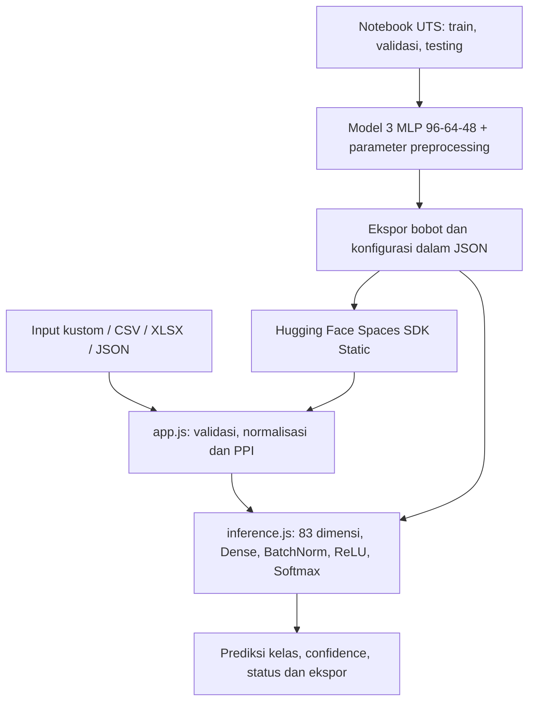

# Source Code Aplikasi dan Hubungan dengan Notebook

[README](../README.md) · [Deployment](DEPLOYMENT.md) · [Galeri demo](HUGGING_FACE.md) · [Folder source UI](../web_static/)

## Mengapa ada folder web_static?

Notebook Google Colab dan website menjalankan peran yang berbeda. Notebook melatih model dan menentukan parameter preprocessing. Website **tidak melatih ulang** model; `app.js` mengambil hasil ekspor dan memanggil `LaptopInference` dari `inference.js` untuk memprediksi spesifikasi yang dimasukkan pengguna.

## Berkas frontend yang disediakan

| Lokasi | Status sumber | Tanggung jawab |
| --- | --- | --- |
| [`web_static/index.html`](../web_static/index.html) | **Sama persis dengan unggahan pengguna terbaru** | Struktur dua tab, panel dan footer |
| [`web_static/app.js`](../web_static/app.js) | **Sama persis dengan unggahan pengguna terbaru** | Peristiwa klik, dropdown kategori, preset, pengolahan batch, metadata hasil |
| [`web_static/style.css`](../web_static/style.css) | Salinan dari source kit terdahulu | CSS light/dark dan layout responsif |
| [`web_static/inference.js`](../web_static/inference.js) | Salinan dari source kit terdahulu | MLP inference JavaScript |
| [`web_static/xlsx-lite.js`](../web_static/xlsx-lite.js) | Salinan dari source kit terdahulu | Parsing dan ekspor Excel |

**Kejujuran versi:** kode yang benar-benar dipakai saat ini pada deployment dapat diperiksa di tab [Files pada Hugging Face](https://huggingface.co/spaces/Xkazuya/LAPTOP-CLASSIFIER/tree/main). Tidak ada akses langsung untuk membandingkan isi *commit live* dengan salinan file pendamping pada saat pengemasan. SHA-256 seluruh file yang tersedia dicatat dalam [`config/frontend_provenance.json`](../config/frontend_provenance.json).

## Perhitungan dan batas input

`app.js` membaca kategori dari `preprocessing_browser.json` hasil `OneHotEncoder` data **training**, bukan daftar kategori yang diketik manual. Hal ini berlaku pada `brand_name`, `processor_brand`, `iter` (seri CPU), `ram_type`, `memory_type`, `gpu_brand`, `gpu_type`, `os`, dan `Touch_Screen`. Antarmuka mengizinkan nilai inti/thread, RAM, penyimpanan, layar, resolusi, garansi dan rating sesuai batas/opsi yang diekspor.

Jaringan dilatih menggunakan **19 fitur asli**, terdiri dari 10 numerik dan 9 kategorikal. Pada input berkas, **18 kolom spesifikasi langsung** dibutuhkan karena `ppi` dihitung dari `resolution_width`, `resolution_height`, dan `display_size`; kolom `model` bersifat opsional hanya untuk nama yang ditampilkan. Dengan demikian, contoh CSV dapat memiliki **19 kolom total (18 input + `model`)** tanpa berarti `model` menjadi fitur. Semua fitur tertransformasi menjadi **83 dimensi `float32`** sebelum masuk ke MLP.

Contoh input model: `brand_name`, `processor_brand`, `iter`, `core_num`, `threads_num`, `ram_num`, `ram_type`, `memory_type`, `memory_size`, `gpu_brand`, `gpu_type`, `display_size`, `resolution_width`, `resolution_height`, `Touch_Screen`, `os`, `warranty`, dan `rating`. Kolom `ppi` otomatis.

## Tiga jenis keluaran yang jangan dicampur

1. **Evaluasi notebook pada 153 data test berlabel:** akurasi Model 3 = **82,35%**, F1 makro = **0,8256**; ini bukti kinerja penelitian.
2. **Prediksi demo UI:** misalnya preset Budget = **Entry-Level 98,59% confidence**; confidence adalah skor Softmax contoh, **bukan akurasi model atau jaminan benar**.
3. **Distribusi batch:** misalnya 72 skenario JSON menghasilkan **4 Entry-Level, 20 Mid-Range, 48 High-End**; jumlah tersebut **bukan label aktual/ground truth**.

## Mekanisme keamanan informasi yang digunakan

- Apabila artefak bobot/preprocessing belum ada atau dimensi tidak sama, aplikasi memblokir inferensi dan menampilkan pesan masalah; tidak membuat angka confidence palsu.
- Bila tersedia, `model_parity_reference.json` digunakan untuk membandingkan tensor dan probabilitas hasil JavaScript terhadap sampel Keras.
- Data unggahan diproses di browser. Dari kode yang diperiksa, tidak ada pengiriman prediksi ke endpoint eksternal; meskipun demikian kebijakan browser dan penyimpanan pengguna tetap harus diperhatikan.
- Ukuran file maksimal **15 MB**, maksimal **5.000 baris** per batch, sebagaimana tertulis di file `app.js` terbaru.
- Prediksi dengan confidence di bawah **0,70** diberi status **Perlu Ditinjau**; hal ini tidak mengubah kelas prediksi menjadi label benar/salah.

## Menjalankan ulang deployment

GitHub ini mendokumentasikan frontend, **bukan tempat menyimpan bobot produksi yang tak disediakan dalam lampiran**. Cara membuat Space, mengunggah kode, menyertakan JSON hasil ekspor, dan menguji fiturnya dijelaskan di [DEPLOYMENT.md](DEPLOYMENT.md).
