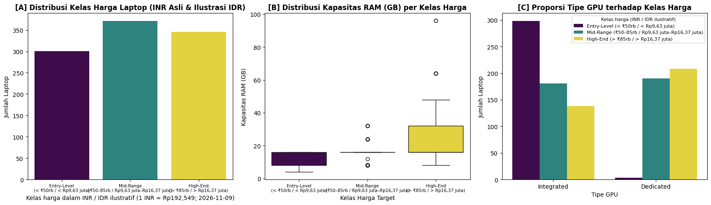
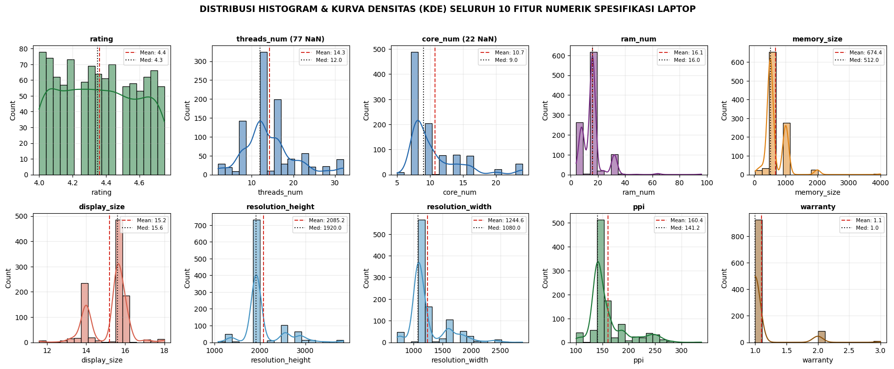
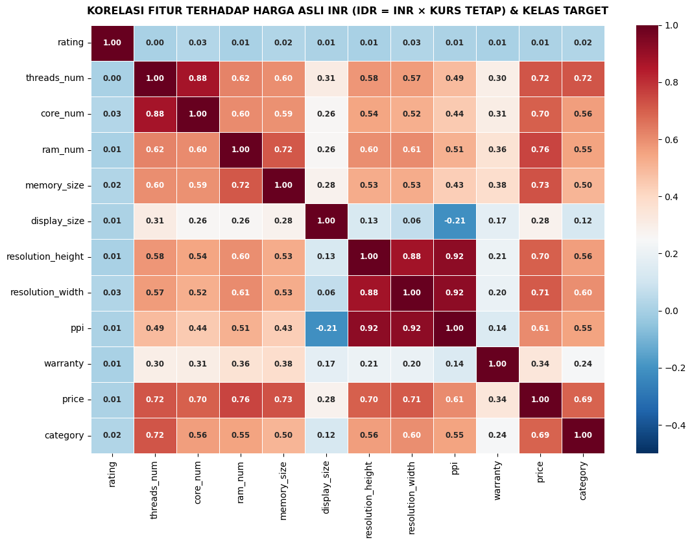

# Section 02 — EDA, audit kualitas, dan pembentukan label

[Kembali ke peta section](../SECTION_MAP.md) · [Buka notebook final](../../notebooks/UTS_DEEP_LEARNING_KELOMPOK_4_FINAL.ipynb) · [Galeri](../GALLERY.md)

## Apa yang kami kerjakan

Kami memeriksa distribusi kelas, histogram fitur numerik, korelasi, duplikasi dan anomali kategorikal. Target dibentuk dari harga INR, tanpa memasukkan harga ataupun ekuivalen IDR sebagai fitur model. Variasi `Nvidia`/`NVIDIA`, `Arm`/`ARM`, serta kategori OS yang tidak seragam dinormalisasi.

## Hasil dan pembacaan

Jumlah data: Entry-Level 301 (29,57%), Mid-Range 371 (36,44%), High-End 346 (33,99%). Audit mencatat 77 nilai `threads_num` kosong dan 22 `core_num` kosong, 78 baris duplikat persis, serta 172 pengulangan kombinasi spesifikasi. Dua baris dari berkas mentah tidak dipaksakan masuk ke versi cleaned ketika pemetaan atributnya tidak sesuai. Kurs tetap 1 INR ≈ Rp192,549 digunakan hanya untuk visualisasi.

## Bukti gambar dari output notebook

*Sumber: output gambar Section 2 pada notebook final.*

*Sumber: output gambar Section 2 pada notebook final.*

*Sumber: output gambar Section 2 pada notebook final.*

## Tabel tersimpan

- [Tabel output 1 (2 × 14)](../../results/recorded/tables/s02_tabel_01.csv)
- [Tabel output 2 (12 × 7)](../../results/recorded/tables/s02_tabel_02.csv)
- [Tabel output 3 (4 × 4)](../../results/recorded/tables/s02_tabel_03.csv)
- [Tabel output 4 (7 × 12)](../../results/recorded/tables/s02_tabel_04.csv)
- [Tabel output 5 (3 × 4)](../../results/recorded/tables/s02_tabel_05.csv)
- [Tabel output 6 (3 × 7)](../../results/recorded/tables/s02_tabel_06.csv)

> **Catatan bukti:** konten pada halaman ini mengikuti hasil eksekusi yang tersimpan dalam notebook. Metrik pada tabel pengujian tidak diperoleh dari berkas input simulasi untuk demo website.
