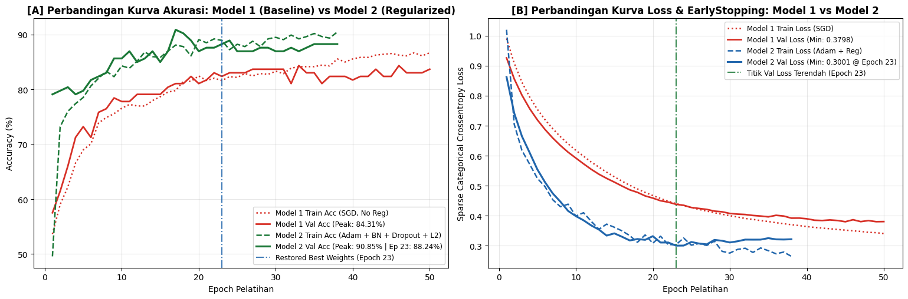

# Section 05 — Dua model pembanding: baseline dan regularized MLP

[Kembali ke peta section](../SECTION_MAP.md) · [Buka notebook final](../../notebooks/UTS_DEEP_LEARNING_KELOMPOK_4_FINAL.ipynb) · [Galeri](../GALLERY.md)

## Apa yang kami kerjakan

Model 1 menggunakan Dense 64→32 dan SGD tanpa regularisasi tambahan. Model 2 menggunakan Dense 128→64→32, Adam, Batch Normalization, Dropout, serta L2. Kedua model dibandingkan pada split yang sama agar hasil selanjutnya punya titik pembanding yang jelas.

## Hasil dan pembacaan

Model 1: 7.555 parameter, akurasi test 79,74% dan F1 makro 0,7990. Model 2: 22.083 parameter, akurasi test 88,24% dan F1 makro 0,8843. Meskipun lebih tinggi pada testing, Model 2 tetap menjadi model pembanding karena fokus judul adalah model hasil hyperparameter tuning.

## Bukti gambar dari output notebook

*Sumber: output gambar Section 5 pada notebook final.*

## Tabel tersimpan

Section ini tidak menghasilkan tabel HTML yang diekstrak menjadi CSV.

> **Catatan bukti:** konten pada halaman ini mengikuti hasil eksekusi yang tersimpan dalam notebook. Metrik pada tabel pengujian tidak diperoleh dari berkas input simulasi untuk demo website.
