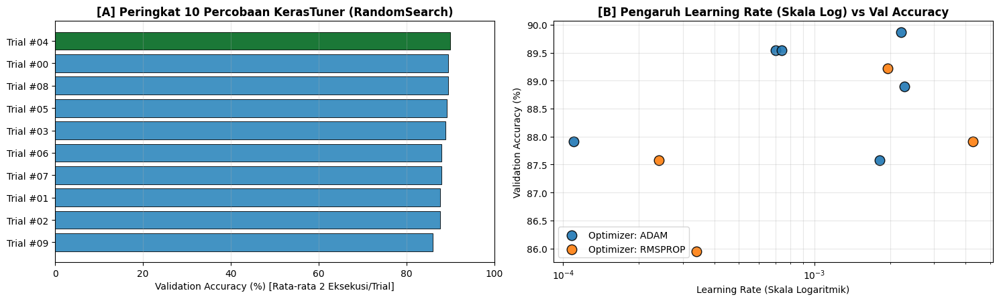

# Section 06 — Hyperparameter tuning dengan KerasTuner

[Kembali ke peta section](../SECTION_MAP.md) · [Buka notebook final](../../notebooks/UTS_DEEP_LEARNING_KELOMPOK_4_FINAL.ipynb) · [Galeri](../GALLERY.md)

## Apa yang kami kerjakan

Pencarian `RandomSearch` dijalankan 10 trial dengan dua eksekusi per trial. Variabel yang dicari meliputi jumlah hidden layer, neuron, optimizer, learning rate, dropout, dan L2; beberapa nilai kontinu diambil dalam skala logaritmik.

## Hasil dan pembacaan

Konfigurasi hasil tuning menggunakan tiga hidden layer 96→64→48, Adam, learning rate 0,0022119679, Dropout 0,2 pada dua layer awal, dan L2 sekitar 1,9529×10⁻⁵. Trial terbaik tercatat #04. Model ini kemudian dilatih ulang pada Section 7.

## Bukti gambar dari output notebook

*Sumber: output gambar Section 6 pada notebook final.*

## Tabel tersimpan

- [Tabel output 1 (10 × 10)](../../results/recorded/tables/s06_tabel_01.csv)

> **Catatan bukti:** konten pada halaman ini mengikuti hasil eksekusi yang tersimpan dalam notebook. Metrik pada tabel pengujian tidak diperoleh dari berkas input simulasi untuk demo website.
