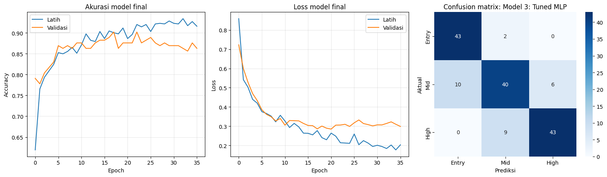

# Section 08 — Evaluasi data test dan contoh prediksi

[Kembali ke peta section](../SECTION_MAP.md) · [Buka notebook final](../../notebooks/UTS_DEEP_LEARNING_KELOMPOK_4_FINAL.ipynb) · [Galeri](../GALLERY.md)

## Apa yang kami kerjakan

Kami membandingkan ketiga model menggunakan accuracy, macro precision, macro recall, macro F1, laporan per kelas, confusion matrix dan contoh sampel berlabel. Model 3 tetap model utama berdasarkan judul, bukan pemilihan ulang berdasarkan test.

## Hasil dan pembacaan

Hasil test Model 3: accuracy 82,35% (126/153 benar), macro precision 0,8244, macro recall 0,8323, dan F1 makro 0,8256. Pada confusion matrix, recall Entry-Level 43/45, Mid-Range 40/56, dan High-End 43/52. Mid-Range memiliki kesalahan terbanyak; prediksi data baru tanpa label aktual tidak diperlakukan sebagai bukti benar/salah.

## Bukti gambar dari output notebook

*Sumber: output gambar Section 8 pada notebook final.*

## Tabel tersimpan

- [Tabel output 1 (3 × 9)](../../results/recorded/tables/s08_tabel_01.csv)
- [Tabel output 2 (3 × 8)](../../results/recorded/tables/s08_tabel_02.csv)
- [Tabel output 3 (11 × 12)](../../results/recorded/tables/s08_tabel_03.csv)
- [Tabel output 4 (3 × 5)](../../results/recorded/tables/s08_tabel_04.csv)

> **Catatan bukti:** konten pada halaman ini mengikuti hasil eksekusi yang tersimpan dalam notebook. Metrik pada tabel pengujian tidak diperoleh dari berkas input simulasi untuk demo website.
