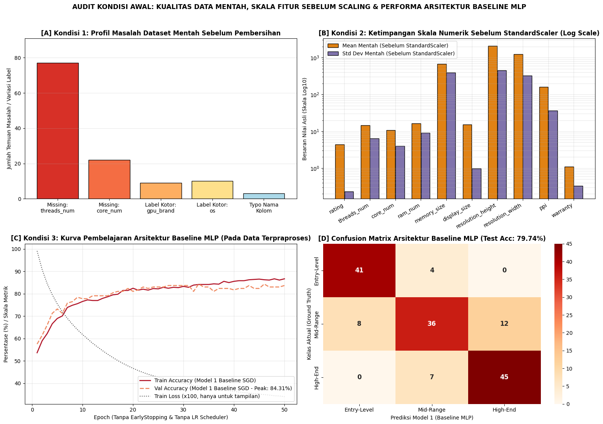

# Section 09 — Audit baseline sebelum optimasi

[Kembali ke peta section](../SECTION_MAP.md) · [Buka notebook final](../../notebooks/UTS_DEEP_LEARNING_KELOMPOK_4_FINAL.ipynb) · [Galeri](../GALLERY.md)

## Apa yang kami kerjakan

Section ini merangkum kondisi awal dari sisi kualitas CSV, rentang fitur numerik, distribusi kelas, dan hasil baseline MLP-SGD. Pemisahan antara persoalan dataset dan kapasitas model penting agar penurunan loss tidak salah diatribusikan.

## Hasil dan pembacaan

Baseline mencapai accuracy test 79,74% dan F1 makro 0,7990 (31 salah dari 153). Masalah skala dan missing value sudah ditangani sebelum ketiga model dilatih; label “sebelum optimasi” merujuk pada arsitektur dan optimizer baseline, bukan bahwa model menerima data mentah tanpa preprocessing.

## Bukti gambar dari output notebook

*Sumber: output gambar Section 9 pada notebook final.*

## Tabel tersimpan

- [Tabel output 1 (4 × 4)](../../results/recorded/tables/s09_tabel_01.csv)

> **Catatan bukti:** konten pada halaman ini mengikuti hasil eksekusi yang tersimpan dalam notebook. Metrik pada tabel pengujian tidak diperoleh dari berkas input simulasi untuk demo website.
