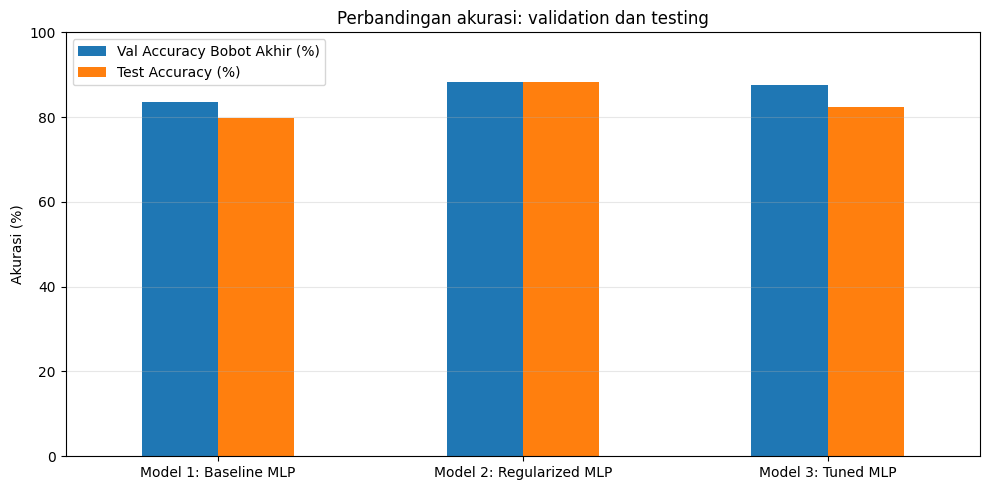

# Section 10 — Ringkasan perbandingan model

[Kembali ke peta section](../SECTION_MAP.md) · [Buka notebook final](../../notebooks/UTS_DEEP_LEARNING_KELOMPOK_4_FINAL.ipynb) · [Galeri](../GALLERY.md)

## Apa yang kami kerjakan

Kami menyandingkan akurasi validasi bobot akhir dan testing, lalu membahas kenaikan dari baseline secara terpisah dari hasil Model 2. Perbandingan ini membantu menyimpulkan pengaruh tuning tanpa menyembunyikan model pembanding yang lebih baik.

## Hasil dan pembacaan

Model 1 / 2 / 3 memiliki akurasi testing 79,74% / 88,24% / 82,35%. Model 3 lebih tinggi 2,61 poin persentase dibanding baseline, tetapi 5,89 poin lebih rendah dari Model 2. Karena itu tuning memberi peningkatan dibanding titik awal, namun belum menang terhadap seluruh kandidat.

## Bukti gambar dari output notebook

*Sumber: output gambar Section 10 pada notebook final.*

## Tabel tersimpan

- [Tabel output 1 (3 × 15)](../../results/recorded/tables/s10_tabel_01.csv)
- [Tabel output 2 (4 × 5)](../../results/recorded/tables/s10_tabel_02.csv)

> **Catatan bukti:** konten pada halaman ini mengikuti hasil eksekusi yang tersimpan dalam notebook. Metrik pada tabel pengujian tidak diperoleh dari berkas input simulasi untuk demo website.
