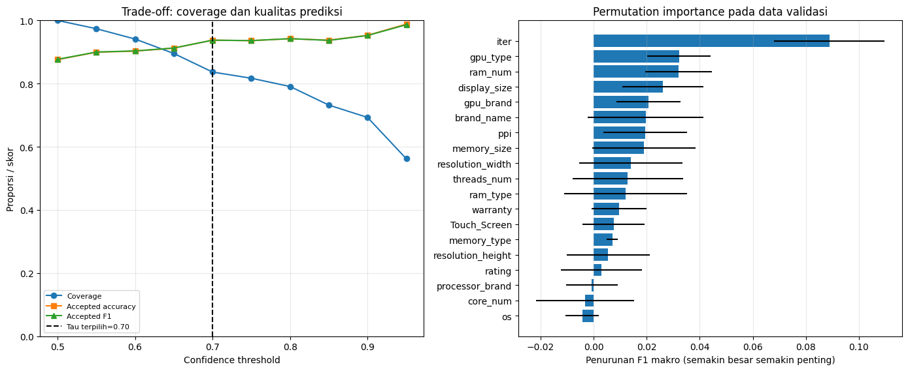

# Section 11 — Dua fitur unik: confidence threshold dan permutation importance

[Kembali ke peta section](../SECTION_MAP.md) · [Buka notebook final](../../notebooks/UTS_DEEP_LEARNING_KELOMPOK_4_FINAL.ipynb) · [Galeri](../GALLERY.md)

## Apa yang kami kerjakan

Fitur pertama memberi label “Perlu Ditinjau” ketika probabilitas tertinggi di bawah ambang, yang dipilih pada validasi sebesar 0,70. Fitur kedua mengacak satu fitur asli sepuluh kali pada validasi untuk memperkirakan perubahan F1 makro, bukan untuk menyimpulkan hubungan kausal.

## Hasil dan pembacaan

Pada test, 126 dari 153 prediksi diterima otomatis, sedangkan 27 perlu ditinjau. Akurasi pada kelompok diterima 89,68%; angka ini bukan akurasi semua data test. Sebanyak 14 dari 27 kesalahan masuk kelompok peninjauan. Penurunan F1 terbesar ketika diacak: `iter` 0,08892; `gpu_type` 0,03215; `ram_num` 0,03196.

## Bukti gambar dari output notebook

*Sumber: output gambar Section 11 pada notebook final.*

## Tabel tersimpan

- [Tabel output 1 (10 × 7)](../../results/recorded/tables/s11_tabel_01.csv)
- [Tabel output 2 (1 × 13)](../../results/recorded/tables/s11_tabel_02.csv)
- [Tabel output 3 (19 × 7)](../../results/recorded/tables/s11_tabel_03.csv)

> **Catatan bukti:** konten pada halaman ini mengikuti hasil eksekusi yang tersimpan dalam notebook. Metrik pada tabel pengujian tidak diperoleh dari berkas input simulasi untuk demo website.
