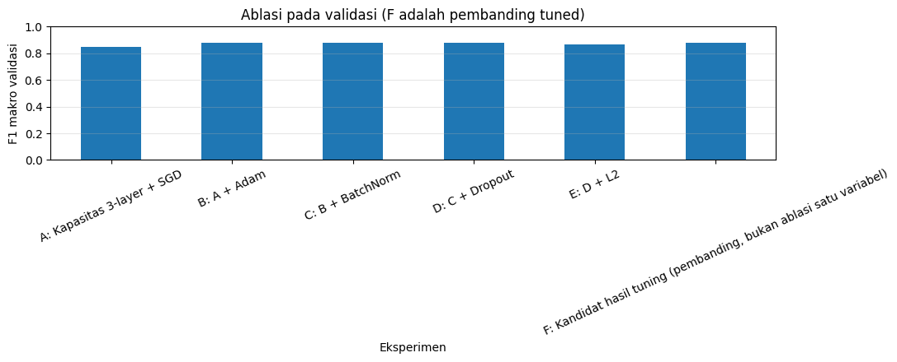

# Section 12 — Ablasi, lima seed, dan sensitivitas generalisasi

[Kembali ke peta section](../SECTION_MAP.md) · [Buka notebook final](../../notebooks/UTS_DEEP_LEARNING_KELOMPOK_4_FINAL.ipynb) · [Galeri](../GALLERY.md)

## Apa yang kami kerjakan

Kami menguji tahapan penambahan optimizer dan teknik regularisasi pada ablasi A–E, menempatkan hasil tuning sebagai pembanding F. Lima random seed dipakai untuk melihat variasi pelatihan. Percobaan group-disjoint berdasarkan nama model dilakukan sebagai uji sensitivitas terhadap produk yang mirip.

## Hasil dan pembacaan

Pada ablasi, penambahan Adam dari A ke B meningkatkan F1 makro validasi 0,8502 menjadi 0,8763. Nilai L2 tidak selalu memperbaiki hasil. Untuk Model 3, rerata accuracy validasi lima seed 87,71% ± 0,85 poin persentase dan rerata F1 0,87765 ± 0,00865. Pembagian group-disjoint menghasilkan sekitar 82,07% accuracy test; itu bukan pengganti evaluasi utama karena pemilihan hyperparameter awal dilakukan pada split acak.

## Bukti gambar dari output notebook

*Sumber: output gambar Section 12 pada notebook final.*

## Tabel tersimpan

- [Tabel output 1 (6 × 12)](../../results/recorded/tables/s12_tabel_01.csv)
- [Tabel output 2 (15 × 8)](../../results/recorded/tables/s12_tabel_02.csv)
- [Tabel output 3 (3 × 9)](../../results/recorded/tables/s12_tabel_03.csv)
- [Tabel output 4 (1 × 10)](../../results/recorded/tables/s12_tabel_04.csv)

> **Catatan bukti:** konten pada halaman ini mengikuti hasil eksekusi yang tersimpan dalam notebook. Metrik pada tabel pengujian tidak diperoleh dari berkas input simulasi untuk demo website.
