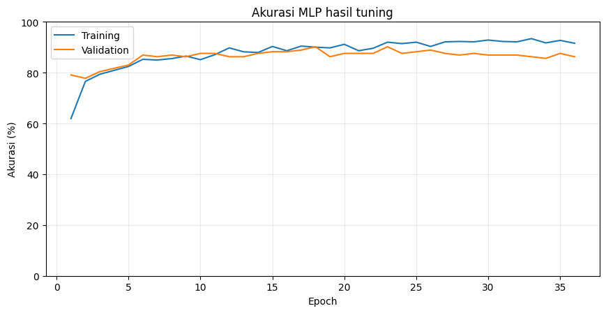
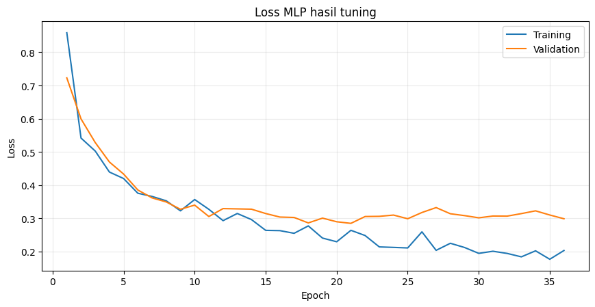
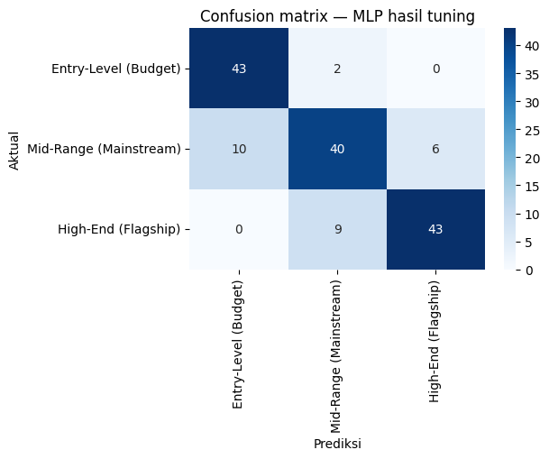
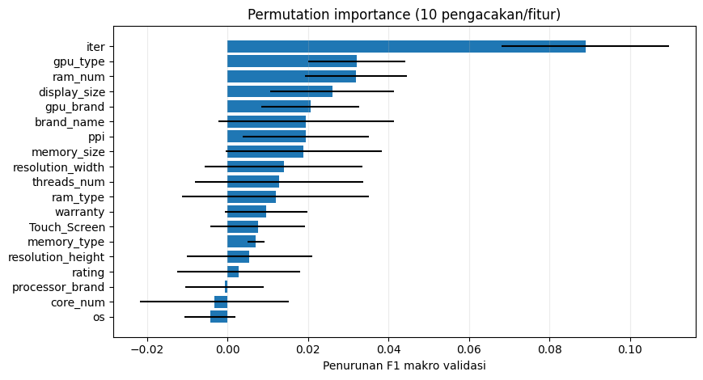
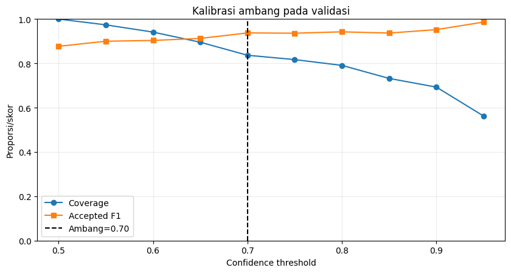

# Section 14 — Peta materi kuliah dan simpulan yang tercatat

[Kembali ke peta section](../SECTION_MAP.md) · [Buka notebook final](../../notebooks/UTS_DEEP_LEARNING_KELOMPOK_4_FINAL.ipynb) · [Galeri](../GALLERY.md)

## Apa yang kami kerjakan

Notebook merangkum penerapan materi Deep Learning Minggu 1–5 untuk dataset tabular: tensor, preprocessing, MLP, regularisasi, optimizer, callback, dan tuning. CNN dari Minggu 6–7 tidak digunakan karena fitur penelitian berupa tabel spesifikasi, bukan citra.

## Hasil dan pembacaan

Hasil akhir utama yang tercatat adalah Model 3 dengan akurasi uji 82,3529%, F1 makro 0,825567, 27 kesalahan dari 153, serta ambang confidence 0,70. Konversi INR/IDR bersifat ilustratif. Kesimpulan tetap memuat keterbatasan dibanding model regularized dan risiko produk serupa pada split acak.

## Bukti gambar dari output notebook

*Sumber: output gambar Section 14 pada notebook final.*

*Sumber: output gambar Section 14 pada notebook final.*

*Sumber: output gambar Section 14 pada notebook final.*

*Sumber: output gambar Section 14 pada notebook final.*

*Sumber: output gambar Section 14 pada notebook final.*

## Tabel tersimpan

- [Tabel output 1 (7 × 6)](../../results/recorded/tables/s14_tabel_01.csv)

> **Catatan bukti:** konten pada halaman ini mengikuti hasil eksekusi yang tersimpan dalam notebook. Metrik pada tabel pengujian tidak diperoleh dari berkas input simulasi untuk demo website.
